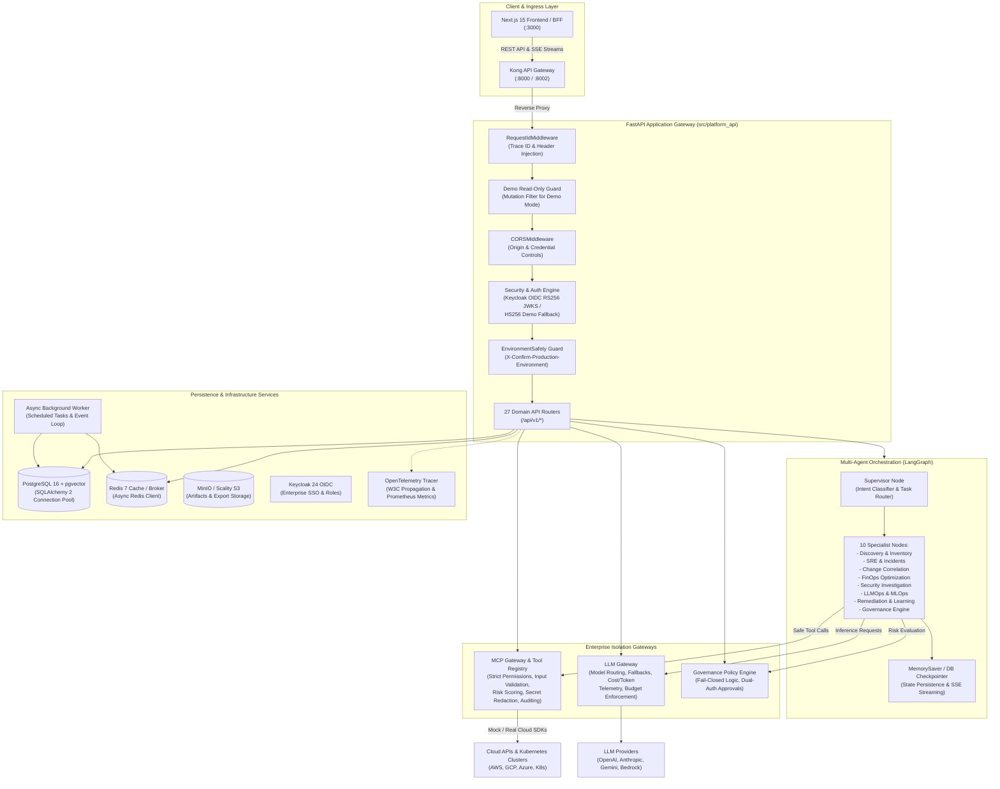
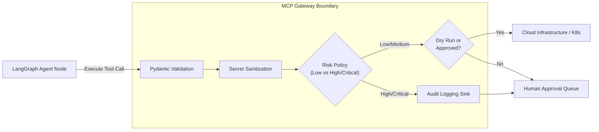
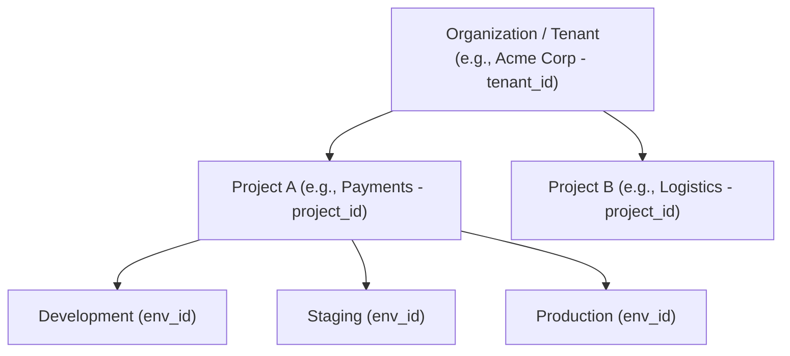
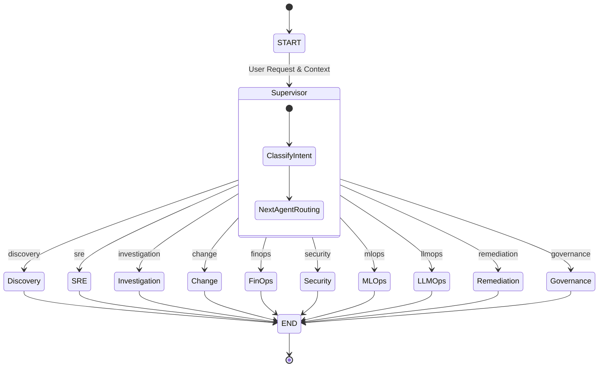
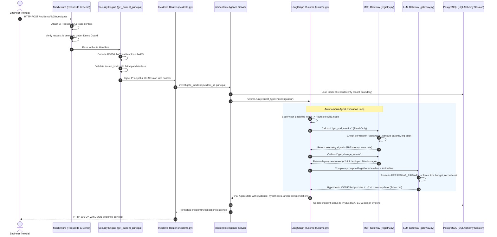

# Backend Architecture & Python Code Structure Guide

> **Document Scope:** Production-grade technical architecture, Python codebase structure breakdown, multi-agent orchestration, security protocols, and meeting presentation playbook for the FastAPI backend in the **AgentOps (Cloud-Agnostic Agentic SRE-FinOps & LLMOps Platform)**.

---

## 1. Executive Summary & Architecture at a Glance

### What is this backend application?
The backend is an enterprise-grade autonomous operations engine built with **Python 3.12**, **FastAPI (0.115+)**, **LangGraph (0.2+)**, **SQLAlchemy 2.0**, and **Alembic**. It powers an intelligent control plane that orchestrates autonomous agents across three mission-critical cloud disciplines:
1. **SRE (Site Reliability Engineering):** Automated incident detection, telemetry signal gathering, change event correlation, hypothesis ranking, and approval-gated remediation.
2. **FinOps:** Multi-cloud cost allocation, usage rollups, spend anomaly detection, idle resource discovery, and rightsizing recommendations.
3. **LLMOps & MLOps:** Multi-model routing (OpenAI, Anthropic, Gemini, Azure), token & cost telemetry, prompt versioning, offline/online evaluation guardrails, and enterprise RAG.

It operates under **strict zero-trust, multi-tenant boundaries**, ensuring that **AI agents never directly execute raw cloud SDKs, Kubernetes commands, or LLM calls without passing through security-governed gateways**.

### High-Level Architecture Diagram



### Technology Stack Summary

| Technology | Production Version | Architectural Role |
| :--- | :--- | :--- |
| **Python** | `3.12.x` | Modern runtime with enhanced performance, typing ergonomics, and async features |
| **FastAPI** | `^0.115.0` | Asynchronous high-performance REST API engine, OpenAPI auto-documentation, Dependency Injection |
| **LangGraph** | `^0.2.0` | Cyclical multi-agent graph orchestrator with stateful checkpointing and update streaming |
| **SQLAlchemy** | `^2.0.0` | Declarative 2.0 ORM, mapped columns, connection pooling, and pgvector compatibility |
| **Alembic** | `^1.14.0` | Incremental, verifiable schema migration pipeline (18 production migrations) |
| **Pydantic / Settings** | `^2.9.0 / ^2.6.0` | Request validation, serialization, and environment configuration with strict validator rules |
| **PyJWT & Cryptography** | `^2.9.0 / ^42.0.0` | OIDC token verification (RS256 with dynamic JWKS caching) and HS256 local verification |
| **Redis** | `^5.2.0` | Distributed caching, session token validation, and async pub/sub |
| **OpenTelemetry** | `^1.28.0` | Distributed tracing (W3C traceparent context), OTLP gRPC export, and Prometheus metrics |
| **Uvicorn** | `^0.32.0` | Lightning-fast ASGI web server with multi-worker process management |
| **Psycopg 3** | `^3.2.0` | High-performance binary PostgreSQL driver with native connection pooling |

---

## 2. Directory & Python Codebase Breakdown

The backend codebase resides in `backend/` and is packaged under `src/platform_api`. It follows clean architecture separation:

```
backend/
├── pyproject.toml                 # Hatchling build system, runtime & dev dependencies, Ruff & Pytest config
├── alembic.ini                    # Database migration configuration for SQLAlchemy 2
├── Dockerfile                     # Multi-stage production container build (non-root runner)
├── requirements-dev.txt           # Developer toolchain pins
├── platform_dev.db                # Zero-config SQLite fallback database for local offline dev
├── migrations/
│   ├── env.py                     # Alembic runner importing all domain models for autogen
│   └── versions/                  # 18 incremental migration files (0001 to 0018)
├── tests/                         # Comprehensive test suite (35+ test files, security proofs, E2E)
└── src/
    └── platform_api/              # Root Python package
        ├── __init__.py
        ├── main.py                # FastAPI app factory, middleware chain, and 27 router mounts
        ├── config.py              # Pydantic Settings v2, environment loading & security validation
        ├── database.py            # SQLAlchemy 2 Engine, SessionLocal, pooling, and resilient init
        ├── security.py            # OIDC RS256/HS256 verification, Principal dataclass, RBAC decorators
        ├── identity_models.py     # SQLAlchemy models for Org/Project/Env hierarchy, Users, Roles, Audits
        ├── identity_repository.py # Data access layer for RBAC, tenancy checks, and user invitations
        ├── environment_safety.py  # Safety guardrails (destructive action confirmation on Production)
        ├── errors.py              # Unified RFC-compliant application error envelope & exception handler
        ├── middleware.py          # RequestIdMiddleware (X-Request-ID, W3C correlation propagation)
        ├── logging_config.py      # Structured JSON logging formatter with timestamp and correlation IDs
        ├── observability.py       # OpenTelemetry spans, Prometheus metrics snapshot, secret redactor
        ├── worker.py              # Async background daemon with graceful signal shutdown
        ├── redis_client.py        # Redis connection helper and async client factory
        │
        ├── api/                   # FastAPI route controllers (27 modular domain routers)
        │   ├── health.py          # Liveness (/health) and readiness (/health/ready) checks
        │   ├── auth.py            # Login, signup, SSO exchange, token issuance, context switching
        │   ├── organizations.py   # Multi-tenant organization CRUD and memberships
        │   ├── projects.py        # Project scoping and member assignments
        │   ├── environments.py    # Environment lifecycles (Development, Staging, Production)
        │   ├── agents.py          # Agent run triggers (/agent-runs) and Server-Sent Events SSE streaming
        │   ├── incidents.py       # Incident ingestion, signal collection, timeline correlation
        │   ├── remediation.py     # Controlled actions (preview, dry-run, execute, post-verify)
        │   ├── approvals.py       # Dual-authorization workflows and human-in-the-loop approvals
        │   ├── tools.py           # Model Context Protocol (MCP) tool discovery & execution endpoints
        │   ├── finops.py          # Cost intake, utilization rollups, anomaly detection, rightsizing
        │   ├── llmops.py          # Model registry, prompt versions, evaluations, telemetry
        │   ├── rag.py             # Knowledge document ingestion, chunking, scoped retrieval
        │   ├── cloud_integrations.py # Cloud credential-free identity references (AWS, GCP, Azure)
        │   ├── secrets.py         # Encrypted secret references and resolution endpoints
        │   ├── ai_query.py        # Natural-language-to-SQL / platform query engine
        │   ├── changes.py         # Deployment & infrastructure change intelligence
        │   ├── learning.py        # Post-remediation metric verification & feedback capture
        │   ├── audit.py           # Compliance audit log query endpoints
        │   └── security.py        # Security findings, IAM events, vulnerability investigations
        │
        ├── agents/                # LangGraph Autonomous Agent Runtime
        │   ├── state.py           # AgentState TypedDict, findings, hypotheses, and execution trace
        │   ├── runtime.py         # StateGraph compiler, checkpointer, run() and stream() engines
        │   ├── nodes.py           # 51KB node implementations: supervisor, sre, finops, remediation, etc.
        │   └── models.py          # Agent execution models and database persistence
        │
        ├── mcp/                   # Model Context Protocol (MCP) Tool Sandboxing
        │   ├── registry.py        # ToolRegistry, ToolSpec, risk policies, idempotency cache
        │   ├── gateway.py         # MCP gateway singleton instance
        │   ├── types.py           # ToolRisk (LOW, MEDIUM, HIGH_RISK, CRITICAL), categories, results
        │   ├── mock_tools.py      # Deterministic Kubernetes & Cloud mock tools for safe execution
        │   ├── redaction.py       # Sensitive credential & API key parameter sanitizer
        │   └── audit.py           # Audit event creation for every tool execution attempt
        │
        ├── llm/                   # LLM Gateway Foundation
        │   ├── gateway.py         # Multi-provider routing, fallbacks, token/cost estimation
        │   ├── providers.py       # MockProvider and base provider contracts
        │   ├── types.py           # LLMRequest, LLMResponse, ModelAlias enum
        │   └── telemetry.py       # In-memory and persisted LLM telemetry collector
        │
        ├── llmops_service/        # Advanced LLMOps Subsystem
        │   ├── service.py         # 31KB production service: model testing, completions, evals
        │   ├── providers.py       # Real adapters: OpenAI, Azure OpenAI, Anthropic, Gemini
        │   ├── models.py          # SQLAlchemy models for prompt versions and evaluation runs
        │   └── schemas.py         # Pydantic schemas for completions, tokens, and model configs
        │
        ├── rag_service/           # Production RAG Engine
        │   ├── service.py         # Document ingestion pipeline and role-filtered retrieval
        │   ├── chunking.py        # Token-aware sliding window text chunking
        │   ├── embedding.py       # Deterministic normalized vector embeddings (cosine math)
        │   ├── reranker.py        # Semantic similarity reranker
        │   ├── repository.py      # Dual-mode persistence: InMemory vs SqlAlchemy pgvector
        │   ├── models.py          # SQLAlchemy models for DocumentRecord and DocumentChunk
        │   └── schemas.py         # Pydantic DTOs with workspace scoping (project & environment)
        │
        ├── governance/            # Policy Engine & Human Approval
        │   ├── policy.py          # Fail-Closed PolicyEngine evaluating risk, tenancy & RBAC
        │   ├── service.py         # Approval request lifecycle (pending, approved, rejected, expired)
        │   ├── repository.py      # Approval state persistence
        │   ├── models.py          # Database schema for approvals and policy audits
        │   └── schemas.py         # Pydantic policy decisions and approval objects
        │
        ├── remediation/           # Controlled Infrastructure Remediation
        │   ├── service.py         # Strictly allowlisted K8s actions, dry-run simulation, idempotency
        │   ├── repository.py      # Remediation execution log persistence
        │   ├── models.py          # Database entities for remediation tracking
        │   └── schemas.py         # Preview, execution request, and result contracts
        │
        ├── learning/              # Feedback Loop & Closed-Loop Verification
        │   ├── service.py         # Compares pre/post metrics, computes recovery confidence
        │   ├── repository.py      # Learning feedback persistence
        │   ├── models.py          # Verification records and operator rating entities
        │   └── schemas.py         # Verification outcomes and feedback schemas
        │
        └── contracts/             # Shared Domain Contracts & Enums
            ├── domain.py          # CloudProvider, Environment, IncidentSeverity, WorkflowStatus
            ├── mcp.py             # MCP protocol DTOs
            ├── llm.py             # LLM exchange schemas
            └── agent.py           # Agent interaction contracts
```

---

## 3. Core Architectural Patterns & Design Decisions

### 3.1 Gateway Boundary Pattern (Defense-in-Depth for AI)
A foundational principle of this platform is that **autonomous agents are never granted direct network access to cloud SDKs, Kubernetes clusters, or LLM provider endpoints**. 

Instead, all interactions are mediated by two hardened gateways:
1. **MCP Gateway (`platform_api/mcp`):** 
   - Every infrastructure operation (e.g., inspecting pods, querying CloudWatch, restarting deployments) is registered as a typed `ToolSpec`.
   - Incoming parameters are strictly validated using Pydantic models before execution.
   - All parameters pass through `sanitize_dict` to redact passwords, JWTs, and AWS access keys from audit trails.
   - Operations classified as `HIGH_RISK` or `CRITICAL` return `status="approval_required"` unless explicit human approval or `dry_run=True` is provided.
   - Idempotency keys prevent duplicate execution of disruptive mutations.
2. **LLM Gateway (`platform_api/llm` & `llmops_service`):**
   - Agent code and API endpoints do not import vendor-specific SDKs (`openai`, `anthropic`, `google-genai`).
   - Requests specify logical model aliases (e.g., `REASONING_PRIMARY`, `REASONING_FAST`, `STRUCTURED_OUTPUT`).
   - The gateway manages intelligent routing, provider fallbacks, time budget timeouts (`time_budget_ms`), token consumption tracking, and estimated USD cost calculation per request.



---

### 3.2 Strict Multi-Tenancy Hierarchy & Scoping
Data and operational isolation are enforced across three distinct structural tiers:



- **Organization (Tenant):** The ultimate boundary for billing, users, and audit records. Cross-tenant access is rejected with HTTP 403 at the dependency layer (`verify_tenant_scope`).
- **Project:** Logical grouping of microservices, RAG documentation, and agent runs.
- **Environment:** Runtime tier (`Development`, `Staging`, `Production`).
- **Production Guardrail (`environment_safety.py`):** Destructive actions targeted at a `Production` environment **fail with HTTP 428 Precondition Required** unless the client provides the HTTP header `X-Confirm-Production-Environment` matching the exact environment slug.

---

### 3.3 Zero-Trust Security, Keycloak OIDC & RBAC
Authentication and authorization are decoupled and enforced via FastAPI dependencies:

```python
# In platform_api/security.py
@dataclass(frozen=True)
class Principal:
    subject: str
    tenant_id: str
    roles: frozenset[str]
    permissions: frozenset[str]
    project_id: str | None = None
    environment_id: str | None = None
    is_owner: bool = False
    read_only_demo: bool = False
```

1. **Dual Token Verification (`_decode_token`):**
   - **Production Mode:** Validates Keycloak RS256 JWTs using public certificates fetched and cached from Keycloak's dynamic JWKS endpoint (`_get_jwks_client`).
   - **Local / Demo Mode:** Validates HS256 tokens signed with `JWT_DEMO_SECRET`. In production, the system startup validator rejects any default secret.
2. **Canonical Permission Normalization:** Supports both dot and colon notations seamlessly (e.g., `inventory.read` and `inventory:read` map bidirectionally).
3. **Role Inheritance:** Automatically expands high-level roles (`ADMIN`, `OPERATOR`, `VIEWER`) into granular permissions via `ROLE_PERMISSIONS_MAP`.
4. **Demo Mode Guard Middleware:** Intercepts incoming requests in demo mode. If `claims["read_only_demo"] is True`, any state-changing HTTP method (`POST`, `PUT`, `DELETE`, `PATCH`) is instantly blocked with HTTP 403, except for safe simulation writes (like `/rag/retrieve` or `/secrets/resolve`).

---

### 3.4 LangGraph Multi-Agent Runtime & SSE Streaming
The agent system is built on **LangGraph's state machine engine (`AgentRuntime`)**:



- **Typed State (`AgentState`):** Carries the complete execution context including `run_id`, `tenant_id`, `project_id`, `environment_id`, gathered `evidence`, `structured_findings`, `hypotheses` with confidence percentages, and `recommendations`.
- **Checkpointing:** Utilizes LangGraph's checkpointer (`MemorySaver` locally, database-backed in production), allowing long-running agent workflows to pause when human approval is required and resume seamlessly after sign-off.
- **Server-Sent Events (SSE) Streaming:** The `stream()` generator emits real-time node updates, steps, and findings directly over HTTP, enabling the Next.js UI to display terminal-style live agent traces.

---

### 3.5 Enterprise RAG Architecture
Located in `platform_api/rag_service`:
- **Document Chunking:** Splits operational runbooks, architecture specs, and incident post-mortems into semantic chunks with overlapping boundaries.
- **Role-Based Access Control (ACLs):** Each document stores an `allowed_roles` list. When a principal queries RAG via `/api/v1/rag/retrieve`, the repository automatically filters out chunks that the user's role cannot view (unless the user has `platform:admin`).
- **Workspace Scoping:** Documents can be scoped globally to a Project or exclusively to a specific Environment (e.g., Production-only disaster runbooks).
- **Source Citations:** Every retrieval returns exact document IDs, chunk indices, and relevance confidence scores so LLM responses cite traceable facts rather than hallucinations.

---

### 3.6 Resilient Database Operations & Migrations
Located in `platform_api/database.py`:
- **Connection Pooling:** Built on SQLAlchemy 2 with pre-ping (`pool_pre_ping=True`), recycling (`pool_recycle=1800`), and bounded overflow (`max_overflow=10`). Stale connections are pruned automatically.
- **Fail-Safe Offline Dev:** If the primary PostgreSQL instance is unreachable during local development, the engine issues a warning and gracefully initializes a local SQLite file (`platform_dev.db`). In `APP_ENV=production`, this fallback is strictly disabled and throws a `RuntimeError`.
- **Alembic Migrations:** 18 sequential migrations manage database evolutions without breaking changes.

---

## 4. End-to-End Request Lifecycle Walkthrough

To understand how the Python code executes in practice, let's trace a real incident investigation request:

```
POST /api/v1/incidents/inc-8921/investigate
Authorization: Bearer <Keycloak_OIDC_Token>
X-Request-ID: 7a92c4b0-112e-4b9a-b4cf-81c009d76e21
```



---

## 5. Domain-Specific Subsystem Breakdown

### 5.1 SRE & Incident Intelligence (`platform_api/incidents`)
- **Deterministic Correlation (`correlation.py`):** Correlates observability metrics (error spikes, latency degradations) with recent deployment and configuration changes within a configurable time window.
- **Evidence-Driven Investigation:** Telemetry is gathered first via deterministic MCP tools. The LLM acts as an analytical reasoning engine over factual evidence, ensuring that the AI never invents metrics.
- **Confidence Scoring:** Outputs ranked hypotheses with transparent evidence citations and explicit confidence percentages (e.g., 0.94 vs 0.35).

### 5.2 FinOps Engine (`platform_api/finops`)
- **Cost & Utilization Ingestion:** Ingests granular cloud billing and resource utilization metrics.
- **Anomaly & Idle Detection:** Evaluates CPU/RAM thresholds against provisioned capacity to identify orphaned volumes, idle compute instances, and unattached IP addresses.
- **Rightsizing Engine:** Calculates recommended instance types, estimated monthly savings in USD, and confidence ratings.
- **Zero-Auto-Mutation Rule:** FinOps recommendations **never** apply infrastructure changes automatically. They require explicit operator sign-off.

### 5.3 LLMOps Service & Guardrails (`platform_api/llmops_service`)
- **Multi-Model Provider Adapters (`providers.py`):** Concrete implementations for OpenAI, Azure OpenAI, Anthropic Claude, and Google Gemini with connection testing.
- **Prompt Versioning & Management:** Stores immutable prompt templates with variables, model assignments, and author attribution.
- **Evaluation Pipeline:** Evaluates completions on seven critical vectors:
  1. *Correctness*
  2. *Groundedness (hallucination avoidance)*
  3. *Retrieval Quality*
  4. *Tool-Call Correctness*
  5. *Latency (ms)*
  6. *Estimated Cost (USD)*
  7. *Success Rate*

### 5.4 Controlled Remediation & Verification Feedback (`platform_api/remediation` & `learning`)
- **Allowlisted Actions Only:** Remediation is strictly restricted to three pre-approved Kubernetes operations:
  1. `restart_pod`
  2. `scale_deployment`
  3. `rollback_deployment`
- **Simulation & Dry-Run Support:** Supports `dry_run=True` to simulate and preview proposed state changes without touching production infrastructure.
- **Human Confirmation Mandate:** `payload.user_confirmed` is strictly enforced. The API will reject any remediation mutation if this flag is false.
- **Closed-Loop Verification (`learning/service.py`):** After remediation executes, the learning service measures metric deltas (e.g., P95 latency dropping from 840ms to 220ms, error rate from 8.4% to 1.2%), computes a recovery confidence score, and stores operator feedback to improve future recommendations.

---

## 6. Production Readiness & Engineering Practices

### 6.1 Bounded Concurrency & Async Worker (`platform_api/worker.py`)
In addition to the web API, the backend includes an asynchronous daemon process:
- Manages background scheduled maintenance, cache evictions, and asynchronous queue processing.
- Listens to OS termination signals (`SIGINT`, `SIGTERM`) to achieve graceful zero-downtime shutdowns.
- Validates database connectivity on startup with exponential backoff retries.

### 6.2 Healthchecks & Kubernetes Probes
- **Liveness Probe (`GET /health` and `/api/v1/health`):** Fast, non-blocking check confirming that the ASGI process is accepting HTTP traffic.
- **Readiness Probe (`GET /api/v1/health/ready`):** Deep healthcheck executing `SELECT 1` against PostgreSQL and `PING` against Redis. If either dependency fails, the pod returns HTTP 503 so Kubernetes stops routing ingress traffic until the service recovers.

### 6.3 Comprehensive Observability & Redaction (`platform_api/observability.py`)
- **W3C Distributed Tracing:** Propagates `traceparent` headers across microservices, associating every MCP tool call, agent step, and LLM inference with a single `trace_id`.
- **Prometheus Metrics:** Tracks cumulative counters for HTTP requests, agent runs, tool executions, and LLM token usage.
- **Automatic Secret Sanitizer:** Telemetry spans automatically redact bearer tokens, AWS secret keys (`AKIA...`), passwords, and JWT strings using compiled regex matchers.

### 6.4 Hardened Containerization (`docker/backend.Dockerfile`)
- **Multi-Stage Build:** The build environment compiles wheels with GCC and `libpq-dev`; the lean runner container retains only runtime libraries.
- **Non-Root Execution:** Runs under an unprivileged user (`appuser`, UID/GID 10001) to eliminate container breakout risks.
- **Baked-In Healthcheck:** Built-in container healthcheck querying the `/api/v1/health` endpoint every 15 seconds.

---

## 7. Meeting Presentation Playbook ("How to Explain in a Meeting")

Use this section to confidently explain the backend architecture, defend design choices, and answer technical questions during stakeholder, leadership, or engineering team meetings.

---

### 7.1 The 30-Second Executive Elevator Pitch
> *"Our backend is an enterprise-grade AI operations platform built with Python 3.12 and FastAPI. Unlike naive AI wrappers that give LLMs direct access to infrastructure, our system implements a **defense-in-depth architecture**. Autonomous agents are orchestrated via LangGraph, but all infrastructure interactions are sandboxed through an **MCP Gateway**, and all AI inferences pass through an **LLM Gateway**. We enforce strict multi-tenancy, fail-closed security policies, human-in-the-loop approvals for critical actions, and full OpenTelemetry traceability. It gives enterprise engineering teams the power of autonomous AI with zero risk of rogue execution or cross-tenant data leaks."*

---

### 7.2 The 2-Minute Architectural Walkthrough
1. **The Core Framework:**
   - *"We chose FastAPI and Python 3.12 because of asynchronous I/O performance, native OpenAPI documentation, and deep compatibility with modern AI and data science tooling."*
2. **The Autonomous Engine:**
   - *"We use LangGraph for agent orchestration. It models operations as a state graph with a Supervisor router and 10 specialist nodes (SRE, FinOps, Remediation, etc.). Workflows are stateful and checkpointed, which allows an agent to pause when it hits a high-risk operation, wait for human approval, and resume exactly where it left off."*
3. **The Security Firewalls (Gateways):**
   - *"Agents never call AWS, GCP, or Kubernetes APIs directly. They must request tools from our Model Context Protocol (MCP) Gateway. The gateway validates inputs with Pydantic, checks RBAC permissions, and classifies risk. Critical actions require human approval."*
   - *"Similarly, our LLM Gateway abstracts away vendor SDKs. It provides dynamic model routing, automatic fallbacks, cost estimation, and token tracking across OpenAI, Anthropic, Gemini, and Azure."*
4. **Data Isolation & Governance:**
   - *"We enforce a strict 3-tier multi-tenancy model: Organization, Project, and Environment. Destructive actions on Production require explicit confirmation headers. Enterprise SSO is integrated via Keycloak OIDC with cryptographic RS256 token verification."*

---

### 7.3 Whiteboard Diagram for the Meeting Room

When presenting on a whiteboard or screen share, sketch these five clear layers:

```
+-------------------------------------------------------------------------+
| 1. INGRESS & CLIENT LAYER                                               |
|    Next.js 15 BFF  <--->  Kong Gateway  <--->  FastAPI (:8000)          |
+-------------------------------------------------------------------------+
                                    |
+-------------------------------------------------------------------------+
| 2. SECURITY & MULTI-TENANCY GUARDS (FastAPI Dependencies)              |
|    Keycloak OIDC (RS256) | RBAC Permissions | Tenant/Env Isolation     |
+-------------------------------------------------------------------------+
                                    |
+-------------------------------------------------------------------------+
| 3. MULTI-AGENT ORCHESTRATOR (LangGraph)                                 |
|    Supervisor Router  --->  10 Specialist Nodes  --->  Checkpointer    |
+-------------------------------------------------------------------------+
                       |                               |
                       v                               v
+-------------------------------+   +-------------------------------------+
| 4A. MCP TOOL GATEWAY          |   | 4B. LLM GATEWAY                     |
|     Pydantic Validation       |   |     Multi-Provider Routing          |
|     Risk Classification       |   |     Fallback Chains                 |
|     Dual Human Approval       |   |     Token & Cost Telemetry          |
|     Secret Redaction & Audit  |   |     Evaluation Guardrails           |
+-------------------------------+   +-------------------------------------+
               |                                       |
+-------------------------------------------------------------------------+
| 5. PERSISTENCE & CLOUD LAYER                                            |
|    PostgreSQL 16 + pgvector | Redis 7 | MinIO S3 | Cloud APIs / K8s    |
+-------------------------------------------------------------------------+
```

---

### 7.4 Tough Meeting Questions & Winning Answers

#### Q1: "Why did you build custom Gateways instead of letting agents use LangChain tools or direct cloud SDKs?"
> **Winning Answer:** *"Giving an LLM direct access to cloud SDKs or raw shell execution is an unacceptable security risk in enterprise production. If an LLM hallucinates, it could delete a production database or leak credentials. By placing the MCP Gateway between the agent and infrastructure, we enforce Pydantic parameter validation, check RBAC permissions, log every attempt to an audit trail, and automatically pause the workflow for human approval if the tool is high-risk. The agent is fundamentally unable to execute unauthorized actions."*

#### Q2: "How do you guarantee that Tenant A cannot see Tenant B's incidents or runbooks?"
> **Winning Answer:** *"Multi-tenancy is enforced at three distinct levels: First, at the JWT layer, every token is cryptographically validated and contains the authenticated `tenant_id`. Second, our FastAPI dependency `verify_tenant_scope` rejects cross-tenant requests before they reach the controller. Third, all database queries in our SQLAlchemy repositories filter strictly on `tenant_id`. Furthermore, our RAG knowledge base enforces tenant and role-based ACLs, so knowledge retrieval is completely isolated."*

#### Q3: "What prevents an agent from accidentally restarting the wrong Kubernetes deployment in Production?"
> **Winning Answer:** *"Three independent safety barriers protect production: First, remediation is restricted to a strict allowlist of three idempotent operations (restart, scale, rollback); arbitrary shell commands are impossible. Second, our `environment_safety` guard requires the HTTP header `X-Confirm-Production-Environment` matching the production environment slug for any destructive action. Third, all mutations require explicit human confirmation (`user_confirmed=True`) and approval records before execution."*

#### Q4: "How do you manage LLM costs, rate limits, and provider outages?"
> **Winning Answer:** *"Our LLM Gateway solves this with unified routing and fallback chains. If OpenAI encounters a rate limit or outage, the gateway automatically falls back to Azure OpenAI or Anthropic within the same logical alias. It enforces strict time budgets (`time_budget_ms`), calculates prompt and completion tokens, computes exact dollar costs in real time, and logs telemetry per tenant, giving FinOps full visibility into AI spend."*

#### Q5: "How does the platform handle long-running or paused workflows when waiting for human approval?"
> **Winning Answer:** *"LangGraph uses stateful checkpointing. When an agent determines that a remediation is needed, it creates an approval request and the graph pauses in an `awaiting_approval` state. The execution thread is saved in our checkpointer. Once the operations manager clicks 'Approve' in the UI, the backend retrieves the exact state thread and resumes execution without re-running previous discovery steps."*

#### Q6: "How do you test this backend without incurring massive cloud and LLM bills?"
> **Winning Answer:** *"We built dual-mode architecture into the platform. In `DEMO_MODE=true` or during automated testing, the system uses deterministic mock tools and provider stubs that mirror real AWS, GCP, Kubernetes, and OpenAI behavior without credentials or external API costs. Our test suite includes over 35 test files covering unit tests, integration tests, failure mode chaos tests, and mathematical security proofs."*

---

## 8. Summary Checklist for Presenters

When presenting this architecture, emphasize these four core pillars:
- [x] **Safety & Governance:** Explain that agents reason over facts, but Gateways and Policies govern execution.
- [x] **Enterprise Multi-Tenancy:** Highlight the 3-tier hierarchy (Org -> Project -> Environment) and RBAC.
- [x] **Observability & Auditability:** Mention that every agent step, tool call, and token is traced via OpenTelemetry.
- [x] **Closed-Loop Feedback:** Conclude with how post-remediation verification and learning loops allow the system to continuously improve operational recovery.
