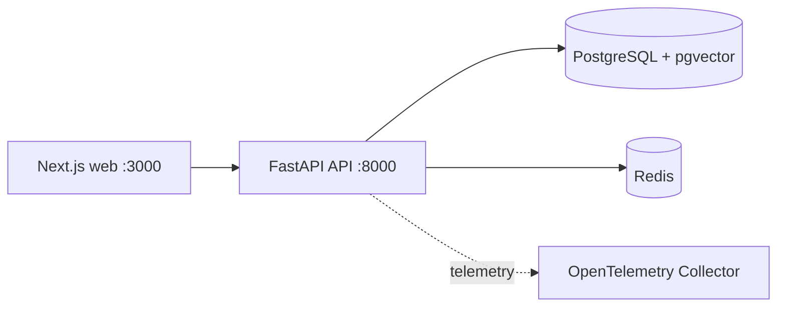

# Phase 0 Bootstrap

## Purpose

Phase 0 establishes the reproducible development foundation for the platform. It does not implement complex agents, provider integrations, remediation, or production workflows.

## Local topology

## Runtime contracts

- Python: 3.12
- Node.js: 22
- API: FastAPI with `/api/v1/health`
- Database: PostgreSQL 17 with pgvector image
- Cache: Redis 7
- Telemetry: OpenTelemetry Collector receiving OTLP

## Boundaries

The API foundation is intentionally small. Agent runtime, MCP Gateway, LLM Gateway, RAG, policy, approval, and audit services are introduced in later phases behind explicit interfaces. No cloud credential is needed for local startup.

## Validation

Run `make setup`, `make lint`, `make typecheck`, `make test`, and `docker compose config`. Use `make docker-up` to start the local dependencies and API/UI foundation.
