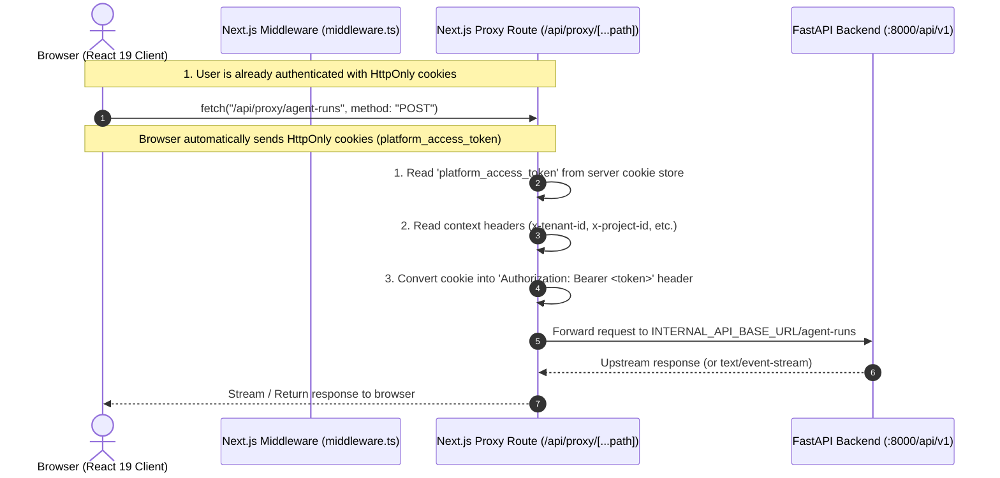

# Frontend Architecture & Next.js Code Structure Guide

> **Document Scope:** Production-grade technical architecture, code structure breakdown, security patterns, and meeting presentation guide for the Next.js 15 frontend application in the **AgentOps (Cloud-Agnostic Agentic SRE-FinOps & LLMOps Platform)**.

---

## 1. Executive Summary & Architecture at a Glance

### What is this application?
The frontend is an enterprise operations console built with **Next.js 15 (App Router)**, **React 19**, and **TypeScript 5.7**. It provides an autonomous cloud control plane across three interconnected domains:
1. **SRE (Site Reliability Engineering):** Real-time incident detection, Kubernetes root-cause analysis, and autonomous remediation workflows.
2. **FinOps:** Multi-cloud cost allocation, spend anomaly detection, and idle resource rightsizing.
3. **LLMOps:** Multi-model routing, prompt versioning, token telemetry, and offline/online evaluation guardrails.

### High-Level Architecture Diagram

```mermaid
flowchart TD
    subgraph Browser ["Client Browser"]
        UI["React 19 Client Components\n(Agents, Operations, FinOps, LLMOps)"]
        WC["Workspace Context\n(Org ➔ Project ➔ Environment)"]
        CG["ContextGuard & RBAC Engine"]
        CookieStorage["HttpOnly Cookies\n(platform_access_token,\nplatform_session)"]
    end

    subgraph NextServer ["Next.js 15 Application Server (Node.js runtime)"]
        MW["Edge/Node Middleware\n(Route Guard & Session Expiration Check)"]
        RSC["Server Components\n(Static Landing Page, Metadata, Layout)"]
        BFF["BFF API Reverse Proxy\n(/api/proxy/[...path])"]
        AuthRoutes["Auth Route Handlers\n(/api/auth/login, /session, /switch-context)"]
    end

    subgraph BackendGateway ["Core Backend Services"]
        FastAPI["FastAPI Upstream Gateway (:8000/api/v1)"]
        Keycloak["Keycloak OIDC Identity Provider"]
        LangGraph["LangGraph Multi-Agent Orchestrator"]
    end

    %% Client flows
    UI --> WC
    UI --> CG
    UI -->|Fetch /api/proxy/*| BFF
    UI -->|Auth Actions| AuthRoutes

    %% Middleware flow
    Browser -->|Requests| MW
    MW -->|Authorized| NextServer
    MW -->|Unauthorized| Browser

    %% Next server to Backend
    BFF -->|Injected Bearer Token\n+ Multi-Tenancy Headers\n(x-tenant-id, etc.)| FastAPI
    BFF -.->|Server-Sent Events (SSE) Stream| UI
    AuthRoutes -->|Credential Verification| FastAPI
    AuthRoutes -.->|OIDC Token Exchange| Keycloak
    FastAPI --> LangGraph
```

### Technology Stack Summary

| Technology | Version | Purpose in this Platform |
| :--- | :--- | :--- |
| **Next.js** | `15.1.0` | App Router, Server-Side Rendering (SSR), API Route Handlers, Edge/Node Middleware |
| **React** | `19.0.0` | Latest React engine with concurrent features, Actions, and enhanced hooks |
| **TypeScript** | `5.7.0` | Strict end-to-end type safety matching backend Pydantic models |
| **CSS System** | Vanilla CSS Tokens | Zero runtime CSS-in-JS overhead; dark-mode design system in `globals.css` |
| **Keycloak JS** | `^26.2.4` | Enterprise OIDC SSO integration |
| **Communication** | REST + SSE | JSON REST endpoints and Server-Sent Events (SSE) for real-time agent output |

---

## 2. Directory & File Structure Breakdown

The codebase follows the Next.js 15 App Router directory convention under `frontend/src`:

```
frontend/
├── package.json               # Dependencies (Next 15, React 19, TypeScript, Keycloak)
├── tsconfig.json              # TypeScript compiler configuration (strict mode, path aliases)
├── next.config.ts             # Next.js build-time & runtime configuration
├── Dockerfile                 # Multi-stage production container build
├── README.md                  # Project overview and runbooks
├── public/                    # Static assets (favicons, SVG illustrations, icons)
└── src/
    ├── middleware.ts          # Global Route Guard, auth cookie validation & session redirector
    ├── app/                   # Next.js App Router (pages, nested routes, route handlers)
    │   ├── layout.tsx         # Root layout (HTML shell, global fonts, providers wrapper)
    │   ├── page.tsx           # Public landing page (Server Component)
    │   ├── globals.css        # Core design system (43KB custom tokens, glassmorphism, responsive grid)
    │   ├── loading.tsx        # Fallback loading spinner during route transitions
    │   ├── error.tsx          # React error boundary for runtime crashes
    │   ├── (public pages)/    # /login, /signup, /capabilities, /demo, /contact, /forgot-password
    │   ├── (console pages)/   # /operations, /agents, /agent-runs, /finops, /llmops, /incidents, etc.
    │   └── api/               # Next.js Server Route Handlers (BFF layer)
    │       ├── auth/          # Authentication endpoints (login, logout, session, switch-context)
    │       └── proxy/         # Catch-all reverse proxy: [...path]/route.ts
    ├── components/            # Reusable UI components & feature containers
    │   ├── providers.tsx      # Composed client context providers
    │   ├── navigation.tsx     # Collapsible sidebar with RBAC-filtered navigation links
    │   ├── context-guard.tsx  # Workspace context requirement enforcer
    │   ├── global-context-selector.tsx # Org -> Project -> Environment picker topbar
    │   ├── hierarchy-switcher.tsx      # Modal / dropdown tenant switcher
    │   ├── agents-experience.tsx       # Interactive Autonomous Agent runner & execution monitor
    │   └── system-status.tsx           # Platform health indicator
    ├── state/                 # Client state management (React Context + Hooks)
    │   ├── workspace-context.tsx # Central store: Active Org, Project, Environment, Role, Permissions
    │   └── keycloak-context.tsx  # Enterprise OIDC authentication session state
    ├── lib/                   # Utility libraries, API client, & permission engine
    │   ├── api.ts             # Strongly-typed isomorphic API client (browser proxy vs server direct)
    │   ├── permissions.ts     # Client-side RBAC engine, role normalization, and permission matrices
    │   ├── auth.ts            # Client session helper types
    │   └── keycloak.ts        # Keycloak initialization logic
    └── types/                 # Shared TypeScript interfaces
```

---

## 3. Core Next.js Architectural Patterns in this Project

### 3.1. App Router Architecture (`src/app/`)
Unlike the legacy Pages Router (`pages/`), Next.js 15 uses the file-system based **App Router** where folders define URL paths, and special files define UI behaviors:
- `page.tsx`: Unique UI rendered for a specific route segment.
- `layout.tsx`: Shared UI that wraps child pages without re-rendering across route changes.
- `loading.tsx`: Instant UI displayed using React Suspense while page data loads.
- `error.tsx`: Client-side error boundary catching runtime exceptions.
- `route.ts`: API Route handler executing on the server (handles HTTP `GET`, `POST`, `PUT`, `DELETE`).

### 3.2. Server Components (RSC) vs. Client Components (RCC)

In production Next.js applications, choosing where code executes is critical for performance and security:

#### 1. Server Components (Default in App Router)
- **Where:** `src/app/page.tsx` (Public Landing Page), `src/app/layout.tsx`.
- **Characteristics:**
  - Execute **only on the server**.
  - Send zero JavaScript to the browser (pure HTML/CSS).
  - Can safely read private environment variables without `NEXT_PUBLIC_` prefix.
  - No React hooks (`useState`, `useEffect`) allowed.
- **Why here:** The landing page (`src/app/page.tsx`) renders static marketing content. Keeping it as a Server Component delivers an instant First Contentful Paint (FCP) and high SEO score without client JS overhead.

#### 2. Client Components (`"use client"` directive)
- **Where:** `src/components/*`, `src/state/*`, `src/app/home/page.tsx`, `src/app/agents/page.tsx`.
- **Characteristics:**
  - Starts with the `"use client"` directive at the very top of the file.
  - Can use browser APIs (`localStorage`, `window.location`) and React hooks (`useState`, `useEffect`, `useCallback`, `useContext`).
  - Executed on client after initial hydration.
- **Why here:** The console is a dynamic operations platform requiring live form input, tab switching, WebSockets/SSE polling, and real-time state synchronization.

---

## 4. Security & The BFF (Backend-For-Frontend) Pattern

This project implements the **BFF (Backend-For-Frontend) Proxy Pattern**, a critical enterprise architecture pattern that prevents credential exposure and centralizes request augmentation.



### 4.1. Why HttpOnly Cookies instead of LocalStorage?
In vulnerable applications, access tokens are stored in `window.localStorage`. If any third-party dependency suffers from a Cross-Site Scripting (XSS) vulnerability, malicious scripts can read `localStorage.getItem("token")` and exfiltrate credentials.

In this platform:
1. `src/app/api/auth/login/route.ts` receives credentials, contacts the backend, and sets tokens inside **`HttpOnly; SameSite=Lax; Secure`** cookies (`platform_access_token` and `platform_session`).
2. Browser JavaScript **cannot read** HttpOnly cookies (`document.cookie` returns empty).
3. Tokens cannot be stolen via XSS.

### 4.2. Next.js Edge/Node Middleware (`src/middleware.ts`)
Acts as the first line of defense before any page or route handler is executed:
- **Public Whitelist:** Allows routes like `/`, `/login`, `/signup`, `/capabilities`, and static assets.
- **Token Check:** Inspects `request.cookies.get("platform_access_token")`.
- **Session Expiry:** Parses `platform_session` JSON cookie; if expired, deletes cookies and redirects to `/login?error=session_expired`.
- **Authenticated Redirect:** If an already logged-in user hits `/login`, it automatically redirects them to `/operations`.

### 4.3. Catch-All BFF Proxy (`src/app/api/proxy/[...path]/route.ts`)
Provides seamless, secure API connectivity:
1. **Dynamic Catch-All Routing (`[...path]`):** Captures any downstream subpath (e.g., `/api/proxy/finops/summary` -> `/finops/summary`).
2. **Bearer Token Injection:** Server-side reads the `platform_access_token` cookie and injects `Authorization: Bearer <token>` into the backend request.
3. **Multi-Tenancy Context Propagation:** Forwards operational headers:
   - `x-tenant-id`
   - `x-project-id`
   - `x-environment-id`
   - `x-request-id` / `x-correlation-id`
   - `x-confirm-production-environment` (mandatory confirmation token for destructive actions).
4. **SSE (Server-Sent Events) Streaming:**
   ```typescript
   if (contentType.includes("text/event-stream") && upstreamRes.body) {
     return new NextResponse(upstreamRes.body as unknown as ReadableStream, {
       status: upstreamRes.status,
       headers: {
         "Content-Type": "text/event-stream",
         "Cache-Control": "no-cache",
         Connection: "keep-alive",
       },
     });
   }
   ```
   Enables real-time streaming of LLM tokens and multi-agent execution steps directly to the browser.

---

## 5. Multi-Tenancy & Hierarchical State Management

Enterprise operations require strict workspace scoping to prevent cross-tenant data leaks.

### 5.1. Three-Tier Tenancy Model
The platform operates on a strict three-tier hierarchy:
$$\text{Organization (Tenant)} \longrightarrow \text{Project} \longrightarrow \text{Environment (dev, staging, prod)}$$

- **Organization:** The highest isolation boundary (owns billing, member directory, enterprise cloud accounts).
- **Project:** Logical grouping of microservices and agents.
- **Environment:** Runtime tier (Development, Staging, Production). Destructive changes to `Production` require explicit confirmation.

### 5.2. `WorkspaceContext` (`src/state/workspace-context.tsx`)
This React Context serves as the central brain of the client application:
- Stores `activeOrg`, `activeProject`, `activeEnvironment`, and `effectiveRole`.
- Exposes async switchers: `switchOrg(id)`, `switchProject(id)`, `switchEnvironment(id)`.
- When switching context, it makes an authenticated call to `/api/auth/switch-context` to synchronize the backend session **before** any child page requests dependent data.

### 5.3. `ContextGuard` Pattern (`src/components/context-guard.tsx`)
To prevent invalid requests and ugly error states, pages wrap their body in `<ContextGuard>`:

```tsx
<ContextGuard featureName="Autonomous Agents" permission="agents:read">
  <AgentsExperience />
</ContextGuard>
```

**Guard behaviors:**
1. If data is still loading: Displays an animated *"Verifying tenancy context & cryptographic isolation..."* spinner.
2. If Organization is missing: Prompts user to select or create an organization.
3. If Project is missing: Directs user to create or select a project.
4. If Environment is missing: Provides an in-place environment provisioning form.
5. If user lacks RBAC permission: Displays an access-denied message without crashing.

### 5.4. Client-side Permission Engine (`src/lib/permissions.ts`)
Decouples UI display logic from hardcoded roles:
- Normalizes disparate roles (`PROJECT_ADMIN`, `OPERATOR`, `MEMBER`, `VIEWER`) into standard tiers (`ADMIN`, `WRITE`, `READ`).
- Exposes helper methods: `permissions.canManageOrganization()`, `permissions.hasPermission("agents:run")`, `permissions.isReadOnlyDemo()`.
- **Demo Mode Protection:** If user is logged into the demo account, all mutation buttons (run agent, create incident, delete resource) are disabled automatically in the UI, while the backend API cryptographically blocks non-read requests.

---

## 6. Data Fetching & Isomorphic API Layer

### 6.1. Isomorphic URL Detection (`src/lib/api.ts`)
The API library dynamically determines the target endpoint depending on whether it executes in the browser or on the Node.js server:

```typescript
const apiBaseUrl =
  typeof window !== "undefined"
    ? "/api/proxy"
    : process.env.INTERNAL_API_BASE_URL ??
      process.env.NEXT_PUBLIC_API_BASE_URL ??
      "http://localhost:8000/api/v1";
```

- **In the Browser:** Calls route through `/api/proxy/*`, letting the BFF attach cookies and security headers.
- **On the Server (SSR / Server Actions):** Calls go straight to `INTERNAL_API_BASE_URL` (`http://api:8000/api/v1`), bypassing browser network hops for maximum performance.

### 6.2. Concurrent Fetching & `AbortController` Lifecycle
Dashboard pages (like `src/app/home/page.tsx`) aggregate metrics from 9 distinct endpoints concurrently:

```typescript
const [approvals, finops, incidents, inventory, health, changes, agentRuns, ragDocuments, llmTelemetry] =
  await Promise.all([
    canViewApprovals ? fetchApprovals(signal) : Promise.resolve(null),
    fetchFinOpsSummary(signal),
    fetchIncidents(signal),
    fetchInventory(signal),
    fetchHealth(signal),
    fetchChanges(signal),
    canViewAgents ? fetchAgentRuns(signal) : Promise.resolve([]),
    fetchRagDocuments(signal),
    fetchLLMTelemetry(signal),
  ]);
```

- **`Promise.all`:** Executes all API calls in parallel, cutting dashboard load time from serial sum ($t_1 + t_2 + \dots$) to $\max(t_i)$.
- **`AbortController`:** Every fetch receives an `AbortSignal`. If the user rapidly switches environments or navigates away, ongoing network requests are cancelled immediately, avoiding memory leaks and race conditions.

---

## 7. Meeting Presentation Guide: How to Explain This

Use these structured talking points when presenting the frontend architecture to technical leads, architects, and stakeholders.

### 30-Second Elevator Pitch
> *"Our frontend is an enterprise operations console built on Next.js 15 and React 19. It uses a Backend-for-Frontend (BFF) reverse-proxy pattern that isolates credentials in HttpOnly cookies, shielding our tokens from browser XSS vulnerabilities. Every request is strictly scoped through a three-tier multi-tenancy hierarchy (Organization, Project, Environment) with client-side context guards and server-enforced RBAC. We deliver real-time agent output using Server-Sent Events, styled with zero-runtime CSS tokens for maximum performance."*

### 5-Minute Deep-Dive Structure for Technical Meetings

| Step | Topic | What to Say in the Meeting |
| :--- | :--- | :--- |
| **1** | **Modern Framework** | *"We adopted Next.js 15 with React 19. We leverage the App Router to cleanly separate lightweight Server Components for public pages from interactive Client Components for our complex operations console."* |
| **2** | **Security Architecture** | *"We do not store tokens in `localStorage`. Authentication uses HttpOnly, SameSite cookies. Our Next.js server proxies requests to FastAPI, converting cookies into Bearer tokens and injecting tenant headers (`x-tenant-id`, `x-project-id`, `x-environment-id`)."* |
| **3** | **Multi-Tenancy Isolation** | *"We have a three-tier tenancy model: Org ➔ Project ➔ Environment. Our `WorkspaceContext` synchronizes selection across the platform, and `<ContextGuard>` guarantees that no component attempts invalid operations before tenant scope is validated."* |
| **4** | **Data & Real-time Flow** | *"We use an isomorphic TypeScript API layer with `AbortController` request cancellation and `Promise.all` parallelization. For agent runs and LLM outputs, our BFF proxy pipes Server-Sent Events (SSE) directly to the UI for real-time streaming."* |
| **5** | **Zero-Flicker Routing** | *"Our Edge Middleware intercepts navigation before pages load, checking session expiry and redirecting unauthenticated traffic without layout shift or UI flickering."* |

### Anticipated Meeting Q&A

**Q1: Why did we build our own Next.js BFF proxy instead of calling the FastAPI backend directly from the browser?**
> **Answer:** *"Security and CORS simplicity. By routing through `/api/proxy`, our secret JWT access tokens never touch browser JavaScript—they remain inside HttpOnly cookies. Additionally, the BFF injects necessary tenancy headers (`x-tenant-id`, `x-project-id`) and handles Server-Sent Events cleanly without CORS preflight overhead."*

**Q2: What happens if a user tries to run a destructive action against a Production environment?**
> **Answer:** *"We have a defense-in-depth model. In the frontend, destructive actions require explicit confirmation of the environment slug. The client sends an `X-Confirm-Production-Environment` header through the BFF. The backend API independently validates this header before executing any mutation."*

**Q3: How does the app handle Read-Only Demo accounts?**
> **Answer:** *"Demo login issues a session with `read_only_demo: true`. The frontend permission engine disables mutation buttons and displays a persistent banner. Even if an attacker bypasses the UI controls, the backend API enforces read-only session claims on every non-GET request."*

**Q4: Why Vanilla CSS rather than heavy component libraries?**
> **Answer:** *"Performance and complete control. In `src/app/globals.css`, we created a dedicated design system using CSS custom properties (variables) for dark mode, glassmorphism, cards, and responsive grids. This eliminates runtime CSS-in-JS overhead, keeps bundle size minimal, and avoids third-party version churn."*

---

## 8. Summary Checklist of Production Engineering Highlights

- [x] **Next.js 15 App Router** with clear Server vs Client Component boundaries.
- [x] **BFF Reverse Proxy** with HttpOnly cookie auth (zero token exposure to browser JS).
- [x] **Edge/Node Middleware** for proactive session validation and route guarding.
- [x] **Three-Tier Multi-Tenancy** (Org $\rightarrow$ Project $\rightarrow$ Env) with header injection.
- [x] **ContextGuard Component** preventing orphaned requests and guiding tenant onboarding.
- [x] **Role-Based Access Control (RBAC)** with granular permission checking and demo-mode gating.
- [x] **Server-Sent Events (SSE)** streaming for real-time agent reasoning and token emission.
- [x] **Isomorphic API Client** with strict TypeScript typing and `AbortController` cancellation.
- [x] **Zero-Runtime CSS Design System** optimized for fast rendering and responsive layouts.
