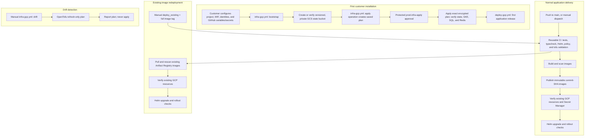

# GCP infrastructure and application delivery

The GCP workflows separate state bootstrap, infrastructure lifecycle, and
application releases. The application workflow never initializes OpenTofu or
creates, changes, or destroys GCP infrastructure.

## Architecture

## Workflow responsibilities

| Workflow | Trigger | Permissions | Behavior |
|---|---|---|---|
| `.github/workflows/ci.yml` | Push to `develop`, PR to `main` or `develop`; reusable by deployment on `main` | `contents: read` | Backend tests/lint, frontend typecheck/build, multi-cloud Helm render, Kong config parse, OPA tests, and backend-free OpenTofu validation. |
| `.github/workflows/deploy-gcp.yml` | Push to `main`; manual `build_and_deploy` or `deploy_existing` | CI: `contents: read`; release: `contents: read`, `id-token: write` | Waits for CI and the protected `prod` environment. New images are scanned before publication and tagged with the checked-out 40-character commit SHA. Existing images are pulled, checked, and rescanned. The job checks live GCP services and applies Helm only. |
| `.github/workflows/infra-gcp.yml` | Manual dispatch only: `bootstrap`, `plan`, `apply`, or `drift` | Bootstrap/plan/apply: `contents: read`, `id-token: write` | Bootstrap configures remote state storage. Plan is review-only. Apply reuses that run's encrypted saved plan after protected `prod-infra-apply` approval. Drift runs refresh-only planning and never applies. |
| `.github/workflows/security.yml` | Push/PR to `main` or `develop`, daily schedule, or manual | `contents: read` | Trivy dependency, IaC/configuration, and secret audit. Critical/high findings with fixes available fail the scan; lower severities and unfixed findings are informational/non-blocking. Image scans are performed by the deployment workflow before publication or deployment. |

Infrastructure and application workflows share a non-cancelling concurrency
group, so a release cannot race an infrastructure operation in GitHub Actions.

## Customer isolation and configuration

For a commercial installation, use a dedicated GCP project per customer and
environment (at minimum separate production from non-production), a unique
state bucket and state prefix per environment, and a separate GitHub production
environment per customer. This module derives the GKE cluster, Artifact
Registry repository, Cloud SQL instance, Memorystore instance, and Pub/Sub names
from `GCP_PROJECT_NAME` and `GCP_ENVIRONMENT`; the workflow validates the
configured cluster/repository against those names. Keep the document bucket
customer-scoped and grant the runtime service account access only to that
bucket. Do not share production state between customers. A shared organization
may host the state bucket in a dedicated state project only after adapting the
bootstrap ownership check and IAM boundary; this workflow intentionally
requires the state bucket to be owned by the configured application project.

Configure these **repository or organization Actions variables** for
`infra-gcp.yml` (one repository per customer is recommended):

| Variable | Required | Meaning |
|---|---:|---|
| `GCP_PROJECT_ID` | Yes | Target customer project ID. |
| `GCP_PROJECT_NUMBER` | Yes | Numeric project number; workflows verify it matches the project ID. |
| `GCP_PROJECT_NAME` | Yes | Terraform resource prefix (lowercase letters/digits/hyphens, beginning with a letter). |
| `GCP_REGION` | Yes | Region for GKE, Artifact Registry, Cloud SQL, and Redis. |
| `GCP_ENVIRONMENT` | Yes | `prod` for the protected production setup. |
| `GCP_NAMESPACE` | Yes | Kubernetes namespace bound to the runtime service account. |
| `GCP_RUNTIME_SERVICE_ACCOUNT` | Yes | Terraform-managed workload identity service-account ID. |
| `GCP_CLUSTER_NAME` | Yes | Must equal `${GCP_PROJECT_NAME}-${GCP_ENVIRONMENT}`. |
| `GCP_TF_STATE_BUCKET` | Yes | Unique GCS bucket for this project's remote state. |
| `GCP_TF_STATE_OBJECT` | Yes | Full object path ending in `/default.tfstate`; its parent path is the GCS backend prefix. |
| `GCP_TF_STATE_LOCATION` | Yes | Immutable bucket location, e.g. the project's approved region. |
| `GCP_ENABLE_PUBLIC_EDGE` | No | `true` only when explicitly enabling the module's public edge. Defaults to `false`. |
| `GCP_ENABLE_PUBLIC_DNS_RECORD` | No | `true` only for an explicitly reviewed DNS/certificate plan. Defaults to `false`. |
| `GCP_DOMAIN` | No | Lowercase approved hostname when using the optional public edge. |
| `GCP_DNS_MANAGED_ZONE` | No | Existing customer-owned Cloud DNS zone for the optional DNS feature. |

Also configure these variables in the GitHub **`prod` environment** used by
`deploy-gcp.yml`: `GCP_PROJECT_ID`, `GCP_PROJECT_NUMBER`, `GCP_PROJECT_NAME`,
`GCP_REGION`, `GCP_ENVIRONMENT`, `GCP_NAMESPACE`, `GCP_CLUSTER_NAME`,
`GCP_REPOSITORY`, `GCP_RUNTIME_SERVICE_ACCOUNT`, and `GCS_DOCUMENT_BUCKET`.
Keep their values consistent with the infrastructure variables above.
`GCP_REPOSITORY` must equal
`${GCP_PROJECT_NAME}-${GCP_ENVIRONMENT}`. The document archive bucket is not
created by this Terraform module; provision it separately and grant the
runtime service account bucket-scoped `roles/storage.objectUser`.

Configure the following **Actions secrets**. Do not use service-account key
files:

| Secret | Used by | Purpose |
|---|---|---|
| `GCP_WORKLOAD_IDENTITY_PROVIDER` | All GCP jobs | Approved Workload Identity Federation provider resource name. |
| `GCP_BOOTSTRAP_SERVICE_ACCOUNT` | Bootstrap only | Temporary/bootstrap identity allowed to create/update the state bucket and bind its policy. |
| `GCP_INFRA_SERVICE_ACCOUNT` | Infrastructure | OpenTofu identity, including bucket-scoped state object access and permissions needed for the declared Terraform resources. |
| `GCP_PUBLISHER_SERVICE_ACCOUNT` | Build/publish only | Artifact Registry writer, scoped to the customer repository. |
| `GCP_DEPLOYER_SERVICE_ACCOUNT` | Deploy only | GKE authentication/RBAC and resource-scoped Secret Manager access; no infrastructure apply role. |
| `TF_DATABASE_PASSWORD` | Infrastructure and deployment | Unique Cloud SQL password; never store in tfvars or command-line arguments. |
| `TF_PLAN_ENCRYPTION_KEY` | Infrastructure apply | Random high-entropy secret of at least 32 characters for the one-day encrypted saved-plan artifact. |
| `JWT_DEMO_SECRET` | Deployment | Application JWT secret (use a strong random value). |
| `OIDC_ISSUER_URL` | Deployment | HTTPS production OIDC issuer. |
| `OIDC_CLIENT_ID` | Deployment | Production OIDC client ID. |
| `OIDC_CLIENT_SECRET` | Deployment | Production OIDC client secret. |

Set GitHub environment protection and branch restrictions on `prod`,
`prod-infra-bootstrap`, and `prod-infra-apply`. Require reviewers on application
production releases, state bootstrap, and infrastructure apply. The plan job
does not invoke apply, but its infrastructure identity can have provider
permissions capable of mutation. Restrict that WIF binding to this repository,
the protected branch, and the infrastructure workflow. Restrict other WIF
bindings to their workflow and expected GitHub environment where present. The
publisher, deployer, bootstrap, infrastructure, and Kubernetes runtime
identities are distinct. Grant no `roles/owner`; use reviewed
resource-scoped/custom roles:

| Identity | Minimum intended scope |
|---|---|
| Bootstrap | Project-level custom role for bucket creation plus bucket get/update and IAM policy get/set. It is only used by the protected bootstrap workflow. |
| Infrastructure | Bucket-scoped `roles/storage.objectAdmin` for state, plus reviewed Terraform provider permissions for the exact module-managed resources. Do not reuse the deployer account. |
| Publisher | Repository-scoped `roles/artifactregistry.writer` for the configured Docker repository. |
| Deployer | GKE cluster discovery and namespace-scoped Kubernetes RBAC; secret-scoped permissions to list/access versions and add a version only when a bootstrap secret has none. It does not get infrastructure apply or registry write permissions. |
| Runtime | The IAM bindings declared by `main.tf`, plus document-bucket access scoped to the customer bucket. It is not a GitHub identity. |

Prefer reviewed custom roles and resource-level bindings over broad project
roles. In particular, do not grant the bootstrap identity project-wide storage
administration or the deployer project-wide Secret Manager administration.
Restrict WIF trust by repository and protected ref; do not rely on GitHub
environment approvals as a substitute for Google-side principal conditions.

The Terraform module creates Secret Manager secret containers, not secret
values. On first app deployment, the workflow adds a value only if a secret has
no versions, then reads each current version and projects it into the
`platform-secrets` Kubernetes Secret. It does not replace existing Secret
Manager versions. Secret Manager rotation therefore remains an explicit
operator action, followed by application redeployment.

## First-time customer installation

1. Create/approve the customer GCP project and enable the required org policies,
   billing, APIs needed for bootstrap, and GitHub OIDC Workload Identity
   Federation. Create distinct bootstrap, infrastructure, publisher, and
   deployer service accounts and configure their WIF bindings without keys.
2. Set the infrastructure repository variables and secrets above. Discover
   the intended state bucket location before setting it; bucket location cannot
   be changed after creation.
3. Configure GitHub environment `prod-infra-bootstrap` with required reviewers
   and protected-branch restrictions. Run **GCP infrastructure lifecycle** on
   `main` with `operation=bootstrap`. It creates or verifies the bucket,
   enforces versioning, uniform access, and public access prevention, verifies
   its project/location, and grants the infrastructure identity
   bucket-scoped `roles/storage.objectAdmin`. It does not create, migrate, or
   overwrite a state object.
4. Configure protected `prod-infra-apply` reviewers. Run the workflow with
   `operation=apply` and `state_mode=initialize` only for a genuinely new
   environment whose exact state object has been verified absent. Review the
   plan in the preceding job logs. Approve the protected apply job to apply
   that exact encrypted plan. The workflow verifies the remote state and
   essential outputs/resources afterward.
5. Configure the `prod` environment variables and secrets, deployer namespace
   RBAC, runtime service account's workload identity, document-bucket access,
   and customer-approved OIDC values. Push to `main` for an automatic
   build/scan/publish/deploy with migrations disabled, or manually run
   `build_and_deploy` with `run_migrations=true` after reviewing migration
   impact.

Do not use `state_mode=initialize` to recover missing existing state. A missing
or inaccessible state object in `existing` mode fails before planning. Recover
from the versioned GCS object or perform a separately approved state migration
before resuming normal operations.

## Normal application release and redeployment

- A push to `main` runs the reusable CI checks, then waits for `prod`
  environment approval. The release builds API, worker, and frontend images;
  blocks critical/high Trivy findings; publishes each image under the commit
  SHA; verifies the existing cluster, repository, SQL, Redis, document bucket,
  and required Secret Manager secrets; and performs Helm upgrade/rollout
  checks. No OpenTofu command or infrastructure job is part of this path.
- Automatic production releases do **not** run database migrations. For
  migration-enabled releases, manually dispatch `build_and_deploy`, use the
  current commit SHA (or leave the input blank), set `run_migrations=true`,
  and review application migration behavior before approving production.
- To redeploy without rebuilding or pushing, manually dispatch
  `deploy_existing`, set the full 40-character image SHA, and leave migrations
  disabled unless separately approved. The workflow pulls all three exact
  images, fails if any tag is absent, scans them again, and deploys those
  images. Existing tags are not silently rebuilt or overwritten.
- Runtime endpoints are read from the live Cloud SQL and Memorystore APIs, not
  from Terraform outputs/state. This avoids granting state access to the
  deployment identity and makes application releases independent of
  infrastructure provisioning.

## Infrastructure operations and state safety

- `bootstrap`: create-if-absent state bucket, set/verify safeguards, and bind
  the infrastructure identity. Bootstrap resources remain outside application
  Terraform state and cannot be removed by normal application deployment.
- `plan`: read-only plan output for review; does not apply.
- `apply`: creates a plan in the same workflow run, encrypts the saved plan,
  waits for `prod-infra-apply` approval, and applies that exact saved plan.
- `drift`: runs `tofu plan -refresh-only -detailed-exitcode`; drift is reported
  as a non-success result and no apply is run.

The backend is intentionally partial in `versions.tf`; the workflow supplies
the bucket and prefix at initialization. GCS backend locking is used. The
bucket must be versioned, use uniform bucket-level access, and enforce public
access prevention. For example, the current repository's old backend values
were bucket `project-cks-aug2026-agentops-tofu-state` and state object
`agentops/prod/default.tfstate`; confirm the real bucket owner, location, and
object before using them. Do not copy these values to another customer.

The bootstrap workflow fails on a wrong project owner/location and never
deletes or recreates a bucket. The infrastructure workflow fails if the
configured state object is missing in `existing` mode, and verifies the state
contains the configured Terraform cluster output before planning/applying.
Using `initialize` requires an absent object and an explicit manual action.
Neither action migrates state. Bucket versioning is the recovery mechanism for
prior object generations; restore the correct generation only through an
approved operator process. If an apply fails, do not rerun with
`state_mode=initialize`: inspect the workflow error and current versioned state,
then run `operation=plan` with `state_mode=existing`. Review any
partially-created resources and the new plan before approving another apply.
Never destroy the state bucket or assume an apply failure rolled back
already-completed provider operations.

## Migration and rollback

1. Before enabling the new infrastructure workflow, inspect the existing
   bucket and state object's project, location, generations, and current
   Terraform outputs with an authorized operator identity. Back up the current
   state object/generation. Do not run `terraform state rm`, `state mv`,
   `-migrate-state`, or apply during this inspection.
2. If the bucket and object match the existing `versions.tf` backend values,
   set `GCP_TF_STATE_BUCKET` and `GCP_TF_STATE_OBJECT` to those exact values.
   Run bootstrap in verify-only effect (it only adds protective settings and
   the scoped infra identity binding), then run `operation=plan`,
   `state_mode=existing`. `tofu init -reconfigure` selects the same
   bucket/prefix; the workflow checks the existing `cluster_name` output.
   Review the plan before any apply.
3. If the verified backend differs, stop. Design a separate migration with
   state backup, ownership and generation checks, a maintenance window,
   explicit `tofu init -migrate-state` approval, and post-migration output
   verification. This workflow intentionally does not automate that migration.
4. Roll back workflow code by reverting the workflow/configuration change,
   not by deleting the bucket or state. Keep the exact existing bucket/prefix
   and state generation. For application rollback, use the protected Helm
   release history (`helm history agentops-platform -n <namespace>` and
   `helm rollback agentops-platform <revision> -n <namespace>`) or manually
   redeploy a previously published SHA. Database schema changes may not be
   reversible; restore from the approved Cloud SQL backup/PITR process when
   necessary.

## Original workflow issues corrected

- Infrastructure planning/apply, image publication, and application deployment
  shared one workflow and had confusing `needs`/output conditions.
- Application deployment initialized remote OpenTofu on routine releases and
  depended on outputs from an apply job that could be skipped.
- The state bucket and state object were hardcoded and assumed to pre-exist;
  first-run state creation was not implemented.
- The Terraform backend hardcoded one customer's bucket/prefix, preventing
  customer-specific state configuration.
- The state bucket was not created by Terraform, but had no explicit,
  idempotent bootstrap lifecycle.
- Deployment accepted a manual tag but did not robustly distinguish build from
  redeployment or prevent replacing a published SHA.
- A state object check was treated as proof of healthy infrastructure; the
  new deploy workflow checks live GKE, Cloud SQL, Redis, Artifact Registry,
  document bucket, and Secret Manager resources.
- The deployer identity combined registry publication, cluster deployment,
  secret access, and infrastructure permissions; the new workflow uses
  separate publisher, deployer, runtime, bootstrap, and infrastructure
  identities.
- The prior secret handling seeded only empty secrets, which is retained, but
  Secret Manager is no longer touched before infrastructure-readiness checks.
- Database migration behavior was implicit in Helm defaults; migration is now
  explicitly disabled by default and opt-in for a reviewed release.
- The security audit previously had `exit-code: 0`; critical/high findings
  were therefore non-blocking. It now fails on actionable critical/high
  dependency, IaC/configuration, or secret findings, while ignoring unfixed
  vulnerabilities and lower severities.

## Validation boundaries

CI checks OpenTofu format/validation without accessing production state. The
infrastructure workflow's plan, apply, bootstrap, and drift paths require
customer credentials and were not exercised as part of local validation. Do
not test these against production from an unapproved workstation or workflow
run.
