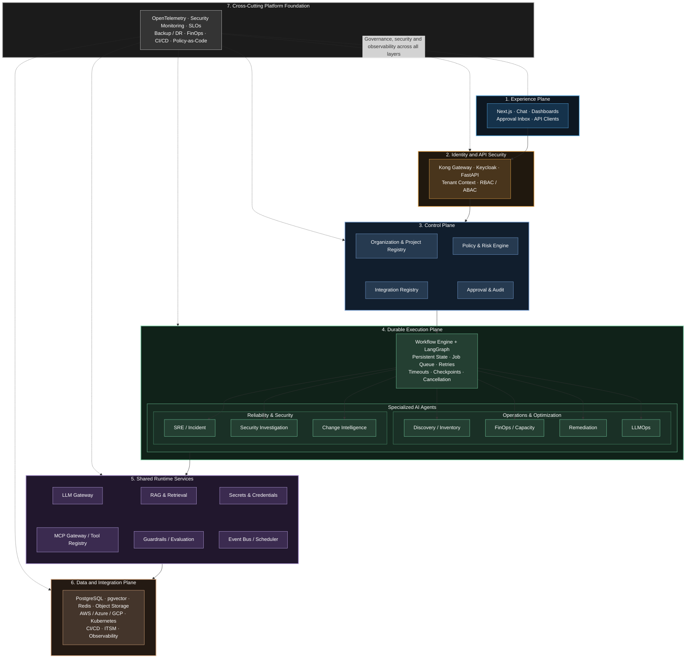

1.User experience and API layer

Next.js Web UI, FastAPI API layer, OAuth2/OIDC/RBAC, and the LangGraph Supervisor/Router.

Purpose: authenticate users, receive requests, and route tasks to specialist agents.

2. Specialist agent layer

Discovery & Inventory, SRE/Incident Intelligence, FinOps & Capacity Optimization, Remediation, LLMOps, Security Investigation, and Change Intelligence.

Purpose: solve domain-specific problems with constrained tools and explicit workflows.

3. Shared platform services

Policy/Risk Engine, Human Approval Engine, OpenTelemetry, RAG Service, LLM Gateway, MCP Gateway, pgvector, PostgreSQL, Redis, and Audit Service.

Purpose: centralize shared infrastructure, governance, model access, knowledge retrieval, and evidence collection.

4. External execution and infrastructure

LLM providers, AWS, Azure, GCP, Kubernetes, CI/CD, ITSM/ticketing, and observability platforms.

Purpose: supply operational data and provide the tools through which agents perform authorized actions.

The most important bottlenecks to fix first
Priority order for enterprise production readiness
01 Tenant isolation and authorization

Every request, database query, retrieved document, tool call, background job, and audit event must preserve organization, project, and environment boundaries.

02 Durable workflow execution

LangGraph orchestration alone does not replace durable job execution, idempotency, distributed locks, recovery, timeouts, and handling of partially completed remediation.

03 Tool security and remediation safety

An agent must not execute arbitrary shell commands, modify cloud resources, or bypass policy simply because a model recommended an action.

04 Integration and credential isolation

Cloud, Kubernetes, CI/CD, ITSM, and observability connections need scoped credentials, secret rotation, health checks, versioning, and revocation.

05 LLM and dependency resilience

Provider outages, throttling, invalid model output, MCP failures, slow queries, and overloaded databases must not collapse the entire workflow.

06 Observability and evaluation

Trace the complete journey from user request to model call, retrieval, tool execution, approval, and final outcome; evaluate correctness and operational safety.

07 Tenant-aware data lifecycle

Define ownership, retention, deletion, encryption, backup, restoration, data residency, and isolation for conversations, traces, documents, and credentials.

Target architecture: what I would change
Your diagram is currently service-centric: it shows which components communicate. An enterprise architecture also needs to show who is allowed to do what, where work executes, how state survives failures, and how actions are verified.

I would organize it into these logical planes.
1. Experience plane

Next.js · Chat · Dashboards · Approval inbox · API clients

2. Identity and API security

Kong Gateway · Keycloak · FastAPI · Tenant context · RBAC/ABAC

3. Control plane
Organization & project registry

Integration registry

Policy and risk engine

Approval and audit

4. Durable execution plane
Workflow engine + LangGraph

Persistent state · Job queue · Retries · Timeouts · Checkpoints · Cancellation

Discovery / Inventory

SRE / Incident

FinOps / Capacity

Security Investigation

LLMOps

Change Intelligence

Remediation

5. Shared runtime services
LLM Gateway

MCP Gateway / Tool Registry

RAG and Retrieval

Guardrails / Evaluation

Secrets and Credentials

Event Bus / Scheduler

6. Data and integration plane

PostgreSQL · pgvector · Redis · Object storage · AWS/Azure/GCP · Kubernetes · CI/CD · ITSM · Observability

7. Cross-cutting platform foundation

OpenTelemetry · Security monitoring · SLOs · Backup/DR · FinOps · CI/CD · Policy-as-code

## AI AgentOps Platform Architecture

Missing components I would add to your diagram
Missing component	Why it matters
Organization, project and environment registry	Establishes authoritative ownership and scope
Durable job/workflow execution	Recovers long-running jobs after crashes or restarts
Event bus or task queue	Decouples API requests from slow agent workflows
Integration registry	Stores connection metadata, scopes, health, and ownership
Secrets manager	Protects cloud credentials, tokens, and integration secrets
Tool execution sandbox	Restricts risky scripts, queries, and generated code
Guardrails and evaluation service	Validates inputs, outputs, actions, and workflow quality
Central configuration and feature flags	Enables safe rollout, versioning, and emergency disablement
Database migration and backup/restore pipeline	Supports recoverability and controlled schema evolution
Usage metering and quota service	Enforces tenant-specific model, API, and infrastructure budgets
Notification service	Delivers approval requests, incident updates, and failure alerts
Data lifecycle service	Handles retention, deletion, archival, and audit requirements

4. Component-by-component review
4.1 Next.js Web UI
Role: the user-facing workspace for platform engineers, SREs, FinOps teams, and administrators.
What it should do
- Show organizations, projects, environments, cloud accounts, and integrations.
- Provide an incident workspace with evidence, hypotheses, timelines, and recommendations.
- Display agent execution steps and their status.
- Present approvals with the proposed action, exact target, expected impact, and rollback plan.
- Show model usage, cost, latency, errors, and workflow history.
- Support streaming responses and reconnection after a browser refresh.
What to add
Use server-side session handling or a well-designed OIDC flow. Do not store long-lived client secrets or provider credentials in browser code. The UI must never be the enforcement point for tenant isolation or permissions; a hidden button is not an authorization mechanism.

Use SSE for one-way progress streaming where possible, and WebSockets only where bidirectional interaction is needed. The backend must support reconnecting clients without starting duplicate workflows.

Acceptance test: a user who changes a project ID in a URL or API payload must not gain access to another project's incident, trace, integration, or approval.

4.2 FastAPI API layer
Role: the application boundary between the UI and the platform.

Keep it responsible for:
- Request validation and API schemas.
- Authentication-token validation.
- Resource-level authorization.
- Tenant and project context resolution.
- Workflow creation, cancellation, and status retrieval.
- Pagination, API versioning, and consistent error responses.
- Rate limiting and request correlation.
Do not execute a potentially 10-minute incident investigation inside an HTTP request handler. Persist the workflow request, enqueue it, return a run_id, and let workers execute it asynchronously.

Example API contract:
POST   /v1/organizations/{org_id}/projects/{project_id}/runs
GET    /v1/runs/{run_id}
POST   /v1/runs/{run_id}/cancel
GET    /v1/runs/{run_id}/events
GET    /v1/runs/{run_id}/approvals
POST   /v1/approvals/{approval_id}/decision

Every endpoint must verify the caller's access to the underlying resource, not just the validity of the URL or token.

4.3 OAuth2 / OIDC / RBAC
Your diagram puts authentication before the LangGraph supervisor. That is correct, but authentication alone is insufficient.
All four identity providers — Keycloak, AWS, Azure, and GCP — can be selected independently as applicable identity integrations; Keycloak is not assumed to broker the other providers.

Distinguish these concepts:
- Authentication: who is the user or service?
- Authorization: what resources and operations can they access?
- Tenant context: which organization, project, and environment does this operation belong to?
- Delegation: which permissions may the agent exercise on behalf of the user?
- Policy: should this particular operation be allowed under the current risk and approval rules?
Use OIDC for user login, OAuth2 access tokens for APIs, RBAC for coarse-grained roles, and ABAC for conditions such as environment, resource tags, ownership, and operation type.

Never trust a client-supplied org_id or project_id without checking membership and permissions against authoritative server-side data.

4.4 LangGraph Supervisor / Router
Role: coordinate the workflow, choose specialist capabilities, track state, and assemble results.

The supervisor should not have unrestricted access to every tool. It should select from a controlled registry of capabilities, while deterministic backend code enforces authorization and execution rules.

A good flow is:
1. Classify the request.
2. Resolve the authorized organization, project, environment, and resource scope.
3. Identify the workflow and required capabilities.
4. Build a typed execution plan.
5. Validate the plan against policy.
6. Invoke specialist agents.
7. Collect evidence and resolve conflicting findings.
8. Request approval if an action requires it.
9. Execute approved actions through a constrained tool runner.
10. Verify results and produce an evidence-backed report.
Add maximum graph steps, per-node deadlines, total workflow deadlines, model-token budgets, tool-call limits, and cancellation handling.

Use persistent LangGraph checkpoints for resumable state and human interrupts. Its documented persistence mechanisms support state recovery and human-in-the-loop workflows, but they do not remove the need for idempotent external side effects. 

Docs by LangChain
+1

Important distinction: a checkpoint can remember that a remediation step was about to execute; it cannot guarantee that a cloud API call wasn't already completed before a worker crashed. That requires execution receipts, idempotency, and reconciliation.

4.5 Specialist agent layer
Avoid implementing every agent as an autonomous loop that independently plans and executes anything it wants.

Treat each specialist as a bounded capability with:
- A defined input and output schema.
- A clear responsibility and allowed tool set.
- A set of evidence sources.
- A risk classification.
- A maximum execution budget.
- A deterministic validation stage.
- A fallback and escalation path.

4.6 Policy / Risk Engine
This is one of the most important services in the design.

It must be an independent enforcement service, not simply a prompt that asks the LLM whether an action is safe.

Inputs should include:
- Organization, project, environment, and resource identity.
- User or service identity and delegated permissions.
- Requested operation and exact parameters.
- Resource criticality and blast radius.
- Change window and current incident state.
- Cost estimate, security classification, and reversibility.
- Applicable organizational policies.
Its output should be a structured decision:
{
  "decision": "require_approval",
  "risk_level": "high",
  "policy_version": "2026-10-01",
  "reason_codes": [
    "production_environment",
    "service_restart"
  ],
  "required_approvals": 1,
  "allowed_operations": [
    "restart_approved_workload"
  ]
}

This is an illustrative contract, not a prescribed schema.

The policy engine must fail closed for privileged write operations if authorization or policy evaluation is unavailable. For read-only diagnostics, you may allow a deliberately limited fallback.

Use deterministic policies such as OPA/Rego or Cedar, or a well-tested custom rules engine. Keep policy decisions separate from model-generated reasoning.

Human Approval Engine
An approval is not just a button in the UI. It is a durable, auditable authorization event.

Each approval record should bind to:
- The exact proposed action and parameters.
- The target resource and environment.
- The requesting user and workflow.
- The risk and policy decision.
- A plan hash or equivalent immutable action reference.
- The approver, decision, and timestamp.
- An expiry time.
- The permitted execution scope.
If the agent changes the action after approval, the changed action must be evaluated and approved again.

Approvals must expire, be revocable where appropriate, and be protected against replay. For high-impact operations, require separation of duties so the requester cannot approve their own action.

LangGraph interrupts are useful for pausing and resuming the workflow, but your approval service must own the business record, identity checks, expiration, and audit history

Audit Service
Keep business audit records separate from ordinary debug logs.

Record:
- Who requested the workflow.
- Which agent and model versions were used.
- Which documents and resources influenced the recommendation.
- Which tools were called, with sanitized arguments.
- Policy decisions and approval events.
- Execution results and verification evidence.
- Relevant correlation IDs and timestamps.
Use append-only or tamper-evident storage for important audit events, with restricted administrative access and a defined retention policy.

Do not indiscriminately log raw prompts, cloud credentials, tokens, sensitive log content, or entire retrieved documents.

PostgreSQL
PostgreSQL should be the authoritative transactional store for your application.

Use it for organizations, users and memberships, projects, environments, integrations metadata, workflows, approvals, policy versions, audit references, and configuration.

Add:
- Foreign keys and uniqueness constraints.
- Transactions around state transitions.
- Database migrations.
- Connection pooling.
- Backups and tested restores.
- Tenant-scoped queries and, where appropriate, row-level security.
- A transactional outbox for reliable publication of workflow events.
Do not rely on application code alone to maintain consistency.

Redis
Use Redis for low-latency, disposable or reconstructable state:
- Caching.
- Short-lived distributed coordination.
- Rate-limit counters.
- Ephemeral session or coordination data.
- Deduplication keys with appropriate expiration.
- Lightweight transient locks.
Do not make Redis the only durable record of an approval, workflow, remediation result, or audit event.

For distributed locks, design for lease expiry and stale lock holders. Where possible, prefer idempotency keys, database constraints, and fencing tokens over fragile lock-based correctness.

Vector DB: pgvector
pgvector is a sensible starting point for enterprise RAG if your corpus and latency requirements fit PostgreSQL's operational profile.

It lets you combine vector similarity search with relational filters and normal database access controls. The critical issue is not whether it is a dedicated vector database; it is whether retrieval preserves authorization boundaries.

Every document chunk should have metadata such as:
organization_id
project_id
environment_id (nullable for broader scope)
source_id
document_version
classification
allowed_groups / ACL reference
ingestion_timestamp
retention_policy

The actual ACL design should support more than one user or group per document; the fields above are conceptual.

Apply access filtering before or within retrieval, then recheck permissions before returning source content. Do not retrieve globally and rely on the LLM to ignore unauthorized documents.

Enterprise RAG

Best for runbooks, architecture documents, incident postmortems, cloud standards, change procedures, security policies, and product documentation.

Flow: query rewrite → authorization filters → hybrid retrieval → reranking → context assembly → grounded answer with citations.

Recommended RAG implementation
1. Ingestion: collect approved documents from Git, object storage, internal knowledge bases, tickets, and postmortems.
2. Parsing: extract text, tables, code blocks, metadata, and relevant document structure.
3. Normalization: remove duplicates and boilerplate while preserving code, commands, and technical identifiers.
4. Chunking: use document-aware chunking, preserving headings, source links, version, and section hierarchy.
5. Embedding: use a versioned embedding model and re-embed documents when necessary.
6. Indexing: store chunks and metadata in PostgreSQL/pgvector; add full-text search for exact terms, identifiers, error codes, and commands.
7. Retrieval: apply tenant and document ACL filters, perform hybrid search, and rerank results.
8. Context construction: select a bounded set of evidence, deduplicate it, and preserve citations.
9. Generation: require the model to distinguish evidence, inference, uncertainty, and unsupported claims.
10. Validation: check citation coverage, answer relevance, freshness, and access control.
11. Feedback: record retrieval failures, missing documents, and user corrections for evaluation.

What documents should you ingest?
Prioritize authoritative, versioned operational knowledge:
- Cloud and Kubernetes architecture diagrams and configuration references.
- Approved runbooks and standard operating procedures.
- Incident timelines, root-cause analyses, and postmortems.
- SLOs, SLIs, alert definitions, and escalation procedures.
- Deployment, rollback, and change-management procedures.
- Infrastructure-as-code modules and approved configuration standards.
- Security policies, IAM standards, threat models, and remediation playbooks.
- FinOps budgets, tagging policies, pricing references, and optimization policies.
- LLM model cards, prompt versions, evaluation reports, and deployment policies.
- API specifications, integration guides, and troubleshooting documentation.
Keep live telemetry, resource inventory, metrics, and current deployment state in their authoritative systems. RAG can search their documentation, but it should not replace real-time APIs for current facts.

Important: a document that was authorized when indexed may later be revoked or moved to another project. Retrieval must respect current ACLs and document versions, not merely the original ingestion permissions.

MCP Gateway
MCP is a protocol for exposing tools and contextual resources to AI applications. The gateway should provide a controlled boundary between your agents and those tools.

Example tools:
aws.list_resources
aws.get_cloudwatch_metrics
kubernetes.get_pods
kubernetes.get_events
itsm.create_incident
itsm.add_worknote
cicd.get_deployment_status
observability.query_metrics

These are illustrative tool names.
What your MCP Gateway needs
- A registry of approved tool servers and tool schemas.
- Per-tool authentication and authorization.
- Project and environment scope enforcement.
- Input schema validation.
- Timeouts, rate limits, and concurrency limits.
- Allowlisted resource operations.
- Secret injection without exposing credentials to the model.
- Tool versioning and compatibility checks.
- Audit records and execution receipts.
- Isolation of untrusted tool-server output.
- Separate permissions for read and write operations.
MCP security guidance and authorization patterns are evolving, so pin compatible protocol versions, verify tokens and scopes, and test the exact clients and servers you deploy. 

MCP Apps
+1

Should you build an MCP server for every integration?
Not necessarily. You can have a small number of domain-specific servers, for example cloud inventory, Kubernetes operations, ITSM, and observability.

Avoid a single enormous MCP server that exposes every privileged action to every agent. Tool discovery does not imply tool authorization.

LLM Gateway
The LLM Gateway should abstract model providers and enforce model-use policies.

Responsibilities:
- Provider and model routing.
- Credential isolation.
- Request and response normalization.
- Timeouts and retry policy.
- Token usage and cost tracking.
- Model-specific rate limits.
- Streaming.
- Model allowlists and data residency constraints.
- Provider health checks and failover.
- Request/response safety checks.
- Per-tenant budgets and model-use permissions.
Use separate model profiles for different tasks:
Task	Model strategy
Request classification	Small, low-latency model or deterministic classifier
Extraction and structured output	Model with reliable schema adherence
Incident reasoning	Strong reasoning model with bounded context
Embeddings	Dedicated embedding model
Reranking	Dedicated reranker where justified
Sensitive operations	Policy engine plus validated action schema; never rely on a model's confidence alone

Keep the LLM gateway responsible for model traffic. The MCP gateway should control tool traffic. Both should share trace IDs, tenant context, security policy references, and audit correlation.

Kong Gateway vs Kong AI Gateway
Kong can be a useful front door for your APIs and AI traffic. Its AI Gateway capabilities include model-provider proxying, AI-aware rate limits, prompt-related controls, routing, and related governance features, depending on product edition and configuration. 

Kong Docs
+2

A practical division is:
- Kong Gateway: inbound routing, TLS, API authentication integration, traffic controls, request limits, and API exposure.
- Kong AI Gateway: model traffic routing, provider abstraction, AI-specific usage governance, and supported AI policies.
- Keycloak: identity provider, login, OIDC, user authentication, and identity federation.
- FastAPI: application-level authorization and business logic.
- Policy/Risk Engine: decisions about whether a requested operation is allowed.
- MCP Gateway / Tool Runner: per-tool authorization and controlled execution.
Avoid running overlapping authentication, retry, caching, and policy logic in multiple layers without clear ownership.

Also, a gateway-level prompt guard is not a complete agent safety system. It cannot independently verify that a cloud resource change is authorized, reversible, and safe.

OpenTelemetry
OpenTelemetry is the instrumentation and telemetry standard, not the dashboard or storage backend. Its context propagation connects traces, logs, and metrics across service boundaries. 

OpenTelemetry
+1

Instrument the full path:
Browser
  → Kong
  → FastAPI
  → LangGraph workflow
  → Specialist agent
  → RAG retrieval
  → LLM Gateway
  → Model provider

LangGraph workflow
  → Policy Engine
  → Approval Service
  → MCP Gateway
  → Tool server
  → Cloud / Kubernetes / ITSM

Each workflow should have a trace ID, and each significant operation should have a span. Propagate trace context across HTTP calls and queue messages.

Record useful attributes such as:
- tenant.id or a suitably pseudonymized tenant identifier.
- project.id, environment.id.
- workflow.id, agent.name, agent.version.
- model.provider, model.name.
- tool.name, tool.operation.
- policy.decision, approval.status.
- retrieval.document_count, retrieval.latency_ms.
- Token usage, cost, queue delay, retries, and execution status.
Do not use high-cardinality identifiers such as raw user IDs or workflow IDs as unrestricted metric labels. Keep those in traces or structured logs.

Avoid exporting raw prompts, authorization tokens, secrets, or sensitive tool arguments by default.

Organization, project, environment and tenant-aware design
This is one of the most important data-model decisions in your platform.

A multi-tenant architecture should not assume that a user, an organization, a project, and a cloud account are interchangeable concepts.
7.1 Recommended hierarchy
Platform

Platform operators · Global configuration · Platform security

Organization / Tenant

Members · SSO settings · Policies · Billing · Data residency · Quotas

Project

Team ownership · Applications · Services · Knowledge sources · Integration bindings

Development

Staging

Production

Resources and integrations

Cloud accounts · Clusters · Services · Repositories · Dashboards · Tickets

The environment names are examples. Organizations may have other environments or multiple production environments.
7.2 Database entities to create
Entity	Important fields / purpose
organizations	id, name, status, plan, security configuration
users	External identity subject, profile and lifecycle
organization_memberships	Organization, user, status, organization role
projects	Organization, project name, owner, settings
project_memberships	User/group, project, role, scope
environments	Project, name, criticality, change policy
integration_connections	Provider, connection metadata, status, owner
integration_bindings	Connection, project/environment scope, allowed capabilities
secret_references	Secret-manager reference, version, rotation metadata
agent_definitions	Agent type, version, allowed tools, configuration
workflow_runs	Scope, initiator, status, graph version, trace reference
workflow_steps	Step state, attempts, results, error classification
approvals	Action reference, approver, expiry, decision
policy_versions	Version, scope, ruleset reference, activation status
knowledge_sources	Source owner, access policy, ingestion status
documents / document_chunks	Source version, classification, ACL reference, embeddings
audit_events	Actor, scope, action, outcome, integrity metadata
usage_records	Tenant, project, model, tokens, cost, usage category

Use UUIDs or similarly opaque identifiers, but do not confuse opaque IDs with authorization. Knowing a UUID must never grant access.
Required database constraints
- All project-owned resources must reference their owning organization.
- Enforce uniqueness within the appropriate scope, not globally by display name.
- Validate that an environment belongs to the requested project and organization.
- Use transactions when creating related resources.
- Apply tenant filtering consistently to every query.
- Consider PostgreSQL row-level security as defense in depth.
- Test background jobs and database connection pooling carefully if using row-level security with session state.

How should integrations be configured at each level?
Use inheritance with explicit overrides, not unrestricted copying of organization-level settings into every project.
Level	Configuration examples
Organization	Allowed providers, SSO, approved model catalog, default retention, maximum spend, global security rules
Project	Application inventory, project-specific runbooks, default observability source, team ownership, project budgets
Environment	Cluster/account binding, production restrictions, change windows, required approval rules, resource allowlists
Integration	Connection metadata, provider, credential reference, permitted API scopes, health and sync state
Agent/workflow	Allowed capabilities, model profile, maximum budget, timeout, retry limits, policy profile

Example
An organization configures an AWS integration and allows read-only discovery. A project binds to that integration. A production environment can inherit the connection but must still apply stricter access rules.

A development environment may permit additional diagnostic operations. Production remediation may require approval even when the same tool is available.

The effective permission should be calculated from:
- The user's current membership and role.
- The requested organization, project, and environment.
- The integration's actual scopes.
- The agent's allowed capabilities.
- The environment's policy.
- The specific resource and operation.
The effective permission must be the intersection of allowed permissions, not the union of everything configured at different levels. Higher-level policies may impose mandatory restrictions that lower-level configurations cannot weaken.

How to manage integrations properly
Treat each integration as a managed resource with a lifecycle:
1. Create a connection through an authorized onboarding workflow.
2. Validate credentials and requested scopes.
3. Store credentials in a secrets manager or secure workload identity configuration.
4. Register connection metadata and ownership in PostgreSQL.
5. Bind the connection to approved projects and environments.
6. Run a health check and verify the minimum required permissions.
7. Sync resource inventory and relevant metadata.
8. Monitor token expiry, API quotas, connection failures, and permission drift.
9. Rotate credentials and renew authorization when needed.
10. Revoke access, stop dependent jobs, and clean up associated data when the connection is removed.
Add an integration status model such as pending, active, degraded, reauthorization_required, and revoked.

Do not assume that an integration working at organization level means every project should automatically gain access to it.

End-to-end workflow for each specialist agent
Every agent should follow a common lifecycle:
1

Request

Receive a typed task and an authenticated execution context.

2

Scope

Resolve tenant, project, environment, permitted resources, and deadline.

3

Gather evidence

Read authoritative APIs, telemetry, approved knowledge sources, and relevant history.

4

Analyze

Use bounded model reasoning and deterministic rules to generate findings.

5

Validate

Check evidence, schema, confidence calibration, authorization, and risk.

6

Decide

Return findings, ask for clarification, escalate, or propose an action.

7

Approve and execute

Obtain required approval and execute only the authorized action.

8

Verify

Check the actual outcome against the expected result.

9

Record and learn

Persist evidence, outcome, cost, trace, and evaluation feedback.

The common lifecycle should be implemented as reusable workflow infrastructure, while each specialist supplies its own domain logic and allowed capabilities.

1 Discovery & Inventory Agent
Use case: identify resources, dependencies, ownership, and configuration drift across AWS, Azure, GCP, openshift, git repo, and Kubernetes.

End-to-end workflow:
1. Accept a discovery request for a project or environment.
2. Resolve the authorized integration bindings.
3. Query provider APIs using read-only credentials.
4. Normalize resource types into a common inventory schema.
5. Record provenance, collection time, region, account, and environment.
6. Discover relationships such as cluster → workload → service → deployment.
7. Compare current inventory with previous snapshots and desired state.
8. Flag missing ownership tags, stale resources, or configuration drift.
9. Store results and report coverage and errors.
Tools: cloud inventory APIs, Kubernetes read APIs, IaC repositories, asset databases.

Guardrails: resource allowlists, API throttling, pagination limits, no write permissions by default.

Fallback: retain the last successful snapshot, mark it stale, and clearly distinguish unavailable resources from resources that no longer exist.

Evaluation: inventory completeness, duplicate rate, ownership accuracy, stale-data rate, and reconciliation accuracy.

2 SRE / Incident Intelligence Agent
Use case: investigate alerts, service degradation, latency spikes, failed deployments, and production incidents.

Workflow:
1. Receive an alert or incident ID.
2. Retrieve the affected service, environment, SLOs, and recent changes.
3. Query metrics, logs, traces, Kubernetes events, and deployment history.
4. Establish an incident timeline with explicit timestamps.
5. Generate candidate hypotheses.
6. Gather additional evidence for each hypothesis.
7. Rank hypotheses based on supporting and contradicting evidence.
8. Recommend diagnostic or corrective actions.
9. Create or update an ITSM ticket with evidence and uncertainty.
10. If remediation is requested, hand off to the Remediation Agent.
11. Verify recovery and generate a post-incident summary.
Do not let the agent equate correlation with causation. A deployment immediately preceding an alert is evidence for a hypothesis, not proof.

Fallback: use deterministic alert rules, recent-change correlation, known runbooks, and a concise summary when the model is unavailable.

Evaluation: time to useful diagnosis, evidence coverage, root-cause precision, unsupported-claim rate, and recommendation acceptance.
3 FinOps & Capacity Optimization Agent
Use case: identify waste, predict capacity pressure, estimate cost, and recommend safe optimization.

Workflow:
1. Retrieve cost and usage data from billing APIs.
2. Normalize account, project, service, region, tags, and billing period.
3. Reconcile cost anomalies with deployments and workload changes.
4. Compare utilization with workload demand and service SLOs.
5. Estimate the financial impact of candidate optimizations.
6. Calculate uncertainty and operational trade-offs.
7. Recommend rightsizing, scheduling, storage lifecycle changes, or capacity adjustments.
8. Evaluate proposed changes against budget and policy.
9. Request approval for changes that modify live infrastructure.
10. Measure actual savings and compare them with the forecast.
Guardrails: minimum capacity constraints, SLO requirements, production change policies, budget boundaries, and no automatic destructive resource removal.

Fallback: provide a conservative report using cached billing data and last-known utilization, with its freshness clearly stated.

Evaluation: forecast error, realized savings, false-positive waste detection, SLO regressions, and avoided unnecessary spend.

4 Remediation Agent
Use case: execute controlled recovery actions, such as rolling back a deployment or restarting a failing workload.

This is the highest-risk agent in your platform.

Workflow:
1. Receive a structured finding and proposed action from another agent.
2. Verify the current incident and resource state independently.
3. Check that the action schema and target are valid.
4. Calculate blast radius, reversibility, and expected impact.
5. Evaluate policy and determine whether approval is mandatory.
6. Present a specific action plan, preconditions, and rollback procedure.
7. Wait for a valid, unexpired approval if required.
8. Revalidate authorization, policy, and resource state immediately before execution.
9. Execute using a narrowly scoped integration identity.
10. Record the external operation ID and result.
11. Verify the desired state and service health.
12. Stop, roll back when safe, or escalate if verification fails.
Never let an agent construct an arbitrary shell command and execute it with broad cloud or cluster credentials.

Use typed operations such as restart_workload, rollback_deployment, or scale_within_bounds, each with server-side validation.

A critical implementation detail is that approval is not a substitute for revalidation: the resource may change while approval is pending.

Fallback: if policy, authorization, or approval services are unavailable, do not perform privileged writes. If execution times out, reconcile the external system's actual state before retrying.

Evaluation: unauthorized action count, policy bypass rate, execution success, rollback success, recovery time, and unintended side effects. The target for unauthorized execution is zero.

5 LLMOps Agent
Use case: monitor model endpoints, detect quality or latency regressions, analyze token costs, and investigate production model failures.

Workflow:
1. Collect model request metrics, traces, evaluation results, and provider status.
2. Group failures by model, prompt version, tenant, task type, and deployment.
3. Detect latency, error-rate, token-usage, and cost regressions.
4. Compare quality metrics against approved baselines.
5. Evaluate fallback models or prompt changes on a controlled dataset.
6. Estimate the impact of switching models.
7. Propose routing, prompt, or deployment changes.
8. Require appropriate approval for production changes.
9. Deploy through controlled configuration or CI/CD.
10. Run canary evaluations and monitor rollback conditions.
Fallback: use static model routing, a known-good model configuration, and cached evaluation baselines when analysis services are unavailable.

Evaluation: task-specific quality, cost per successful task, p95 latency, error rates, regression detection accuracy, and rollback effectiveness.

6 Security Investigation Agent
Use case: investigate IAM anomalies, suspicious changes, risky configurations, vulnerability findings, and security alerts.

Workflow:
1. Receive a security event or alert.
2. Retrieve the relevant identity, resource, change history, and policy context.
3. Query approved cloud audit APIs, security findings, and relevant logs.
4. Correlate events and build an evidence timeline.
5. Identify possible attack paths and affected resources.
6. Cross-check findings against approved security standards and runbooks.
7. Classify severity with deterministic rules and supporting evidence.
8. Create or update a security incident.
9. Recommend containment or remediation.
10. Require authorized approval for impactful changes unless an explicitly approved emergency automation policy applies.
11. Verify containment and preserve evidence.
Guardrails: read-only by default, restricted access to sensitive logs, no credential disclosure, and strict approval rules for account lockdown or access revocation.

Fallback: escalate to human security responders when evidence is incomplete or the required data sources are unavailable.

Evaluation: detection precision and recall on labelled cases, severity calibration, investigation completeness, and time to escalation.

7 Change Intelligence Agent
Use case: assess deployment risk, change conflicts, dependencies, and likely impact before a release.

Workflow:
1. Receive a proposed change, pull request, deployment, or change ticket.
2. Retrieve affected services, infrastructure dependencies, and the change window.
3. Compare the proposal with previous deployments and incidents.
4. Check policy compliance, ownership, maintenance windows, and test results.
5. Identify conflicting changes and potential blast radius.
6. Generate a risk assessment with evidence and assumptions.
7. Recommend approve, delay, stage, or require additional testing.
8. Route the result to the appropriate approval workflow.
9. Monitor deployment health and compare expected with actual results.
Guardrails: the agent does not replace mandatory CI checks, code-owner approvals, or change-management controls.

Fallback: use deterministic deployment gates and policy checks; if required evidence is missing, mark the assessment incomplete.

Evaluation: change-failure rate, risk-ranking accuracy, incident prediction precision, and false-positive blocking rate.

How all agents work together: a complete incident example
Suppose an engineer asks:
Investigate why our production Kubernetes application has high latency, identify the likely root cause, estimate the financial impact, and propose a safe fix.

Here is the recommended end-to-end workflow.
01

Authenticate and scope

Keycloak authenticates the engineer. FastAPI resolves the organization, project, production environment, and permitted integrations.

02

Create a durable run

Persist the workflow and enqueue it. Return a run ID; propagate trace and tenant context to the worker.

03

Collect evidence

Discovery identifies affected resources. SRE gathers metrics, logs, traces, events, and recent deployment history.

04

Investigate with RAG

Retrieve relevant runbooks, service ownership information, and similar postmortems. Enforce document ACLs and cite evidence.

05

Form and test hypotheses

The SRE agent correlates evidence, checks alternative explanations, and identifies what remains unknown.

06

Estimate impact

FinOps estimates capacity and cost implications. Change Intelligence checks recent changes and deployment risk.

07

Create a remediation proposal

Remediation produces a typed action, preconditions, blast-radius estimate, verification checks, and rollback plan.

08

Enforce policy

The policy engine checks environment criticality, resource permissions, action risk, and approval requirements.

09

Human approval

If required, persist the pending approval and pause execution. Notify the authorized approver.

10

Execute safely

Revalidate the approval and target state. Call the MCP tool through the constrained execution service using scoped credentials.

11

Verify recovery

Query Kubernetes and observability systems again. Compare latency, errors, health checks, and SLOs against the expected outcome.

12

Close the loop

Update the incident ticket, persist execution evidence, report actual results, and capture evaluation feedback.

Important workflow rules
- Read-only evidence gathering can run in parallel when the dependencies allow it.
- Resource-changing operations must pass through a centralized authorization and execution boundary.
- A missing integration must produce an explicit evidence gap, not an invented conclusion.
- An approval pause must survive worker restarts and browser disconnections.
- A timeout must not automatically imply that an external operation failed.
- A successful API response is not sufficient evidence that the service recovered.
- Every recommendation should distinguish observed facts from hypotheses and proposed actions.

Durable execution, queues and concurrency
Your diagram shows LangGraph, but not how the platform will handle large numbers of simultaneous workflows.

This is a potential enterprise bottleneck.
Recommended execution model
Separate the synchronous API from long-running workflow execution.
FastAPI

Validate → authorize → persist run → enqueue

Durable queue / workflow scheduler

Backpressure · Retry policy · Dead-letter handling · Concurrency limits

Worker pool A

Read-only investigation

Worker pool B

Privileged execution

Persistent state and execution receipts in PostgreSQL; queue implementation selected to match workload requirements.

What to implement
1. Durable workflow state and checkpoint persistence.
2. Separate worker pools for different risk levels and workload profiles.
3. Per-tenant concurrency and queue quotas.
4. Timeouts at the API, agent, model, tool, and total workflow levels.
5. Exponential backoff with jitter for transient errors.
6. Idempotency keys for workflow creation and external actions.
7. A transactional outbox or equivalent reliable event publication.
8. Dead-letter queues and a controlled replay process.
9. Cancellation and cooperative shutdown.
10. Reconciliation for actions whose outcome is unknown.
LangGraph is appropriate for stateful agent orchestration. Use its persistence capabilities, but don't assume it replaces every queue, scheduler, or job-execution concern. 

Docs by LangChain
+1

Queue choice: start with a reliable PostgreSQL-backed queue if workload and throughput justify that simplicity. Consider a dedicated broker or durable workflow platform when concurrency, event volume, scheduling, or long-running execution demands it. Do not introduce Kafka, Temporal, and several other orchestration systems simultaneously without a specific need.

Metrics to monitor
Layer	Metrics
API	Request rate, p50/p95/p99 latency, errors, rate-limit rejections
Workflow	Queue age, duration, success/failure, cancellation, retry count
Agents	Step count, tool calls, completion rate, budget exhaustion
LLM	Time to first token, response latency, errors, tokens, cost, fallback rate
RAG	Retrieval latency, zero-result rate, reranker latency, citation coverage
MCP	Tool latency, failures, authorization denials, timeouts
Policy	Allow/deny/approval decisions, evaluation latency, policy errors
Approvals	Pending count, time to decision, expiry, rejection rate
Database	Connections, query latency, lock contention, replication lag
Redis	Memory, evictions, cache hit rate, connection failures
Queue	Backlog, oldest message age, worker utilization, dead-letter count
Integration	API quota errors, credential expiry, sync freshness
Security	Failed login spikes, denied access, suspicious tool activity

SLOs and alerting
Define service-level objectives based on actual customer expectations and workload measurements. For example:
- Interactive API availability.
- Time to first useful investigation result.
- Workflow completion time for common tasks.
- Approval notification delivery.
- Inventory freshness.
- Percentage of tool operations with verifiable outcomes.
- Maximum acceptable loss of telemetry during outages.
Do not use a single overall "agent success rate." A workflow can return a polished answer while being factually wrong, incomplete, or unsafe.

Trace and log privacy
AI telemetry can accidentally become a second database of customer secrets.
- Redact secrets before export.
- Avoid capturing raw prompts and responses by default.
- Use controlled, sampled diagnostic capture for investigations.
- Enforce tenant-aware access to traces and logs.
- Separate operational telemetry from security audit evidence.
- Define retention, deletion, and data residency requirements.
- Ensure the telemetry collector cannot become a route for leaking data to unauthorized destinations

Fallbacks and failure handling
Your system needs a deliberate fallback strategy at every important boundary.
Failure	Recommended behavior
Primary LLM unavailable	Retry transient failures within a deadline, then use an approved compatible fallback model
Fallback model unavailable	Return partial evidence, mark analysis unavailable, and stop model-dependent steps
RAG service unavailable	Use approved direct sources where possible; otherwise state that knowledge retrieval is unavailable
Vector index stale	Apply freshness rules and disclose the data age
MCP server unavailable	Retry safe read calls; report unavailable evidence; do not invent tool results
Cloud API rate limited	Honor provider retry guidance, use bounded backoff, and limit concurrency
Redis unavailable	Bypass disposable caches when safe; protect the database and enforce security-sensitive limits elsewhere
PostgreSQL unavailable	Reject operations that require durable writes; do not pretend that workflows or approvals were saved
Queue unavailable	Reject or temporarily defer new work; avoid creating untracked executions
Policy engine unavailable	Deny privileged writes; allow only explicitly designed safe fallback behavior for read-only operations
Approval service unavailable	Pause high-risk actions
Human approval expires	Do not execute; request a fresh approval if the workflow remains valid
Worker crashes	Resume from durable state and reconcile external side effects
Observability backend unavailable	Buffer telemetry within bounded limits; do not block critical operations indefinitely
Integration credential revoked	Stop dependent work, mark the integration degraded, and request reauthorization

Retry rules that matter
Retries are not universally safe.
- Retry read operations when transient failures justify it.
- Retry model requests within explicit latency and cost budgets.
- Use idempotency keys for writes whenever the downstream API supports them.
- Never blindly repeat a deployment, restart, payment-like action, or infrastructure mutation after a timeout.
- Reconcile actual external state before deciding whether a write should be retried.
- Keep fallback models and tools within the same tenant, policy, and data-residency constraints.
Use circuit breakers to stop repeatedly calling unhealthy dependencies, bulkheads to isolate failures, and bounded queues to prevent overload.

Agent guardrails and evaluation
You need two different things:
1. Guardrails prevent or constrain unsafe behavior at runtime.
2. Evaluation measures whether the system performs well enough and detects regressions.
Neither replaces the other.
13.1 Defense-in-depth guardrails
Input guardrails

Validate request schemas, user permissions, resource scope, file size, and untrusted content.

Retrieval guardrails

Apply document ACLs, tenant filters, freshness constraints, citation requirements, and sensitive-data controls.

Model guardrails

Use constrained outputs, tool allowlists, bounded context, prompt-injection defenses, and model-use policies.

Tool guardrails

Validate arguments, enforce per-tool authorization, restrict network egress, sandbox code, and limit execution time.

Action guardrails

Apply policy-as-code, risk classification, approval rules, blast-radius limits, and rollback or stop conditions.

Output guardrails

Validate claims against evidence, check citations, redact sensitive data, and communicate uncertainty.

Operational guardrails

Enforce budgets, step limits, concurrency quotas, deadlines, cancellation, and circuit breakers.

Common failure modes to explicitly test
- Prompt injection inside a runbook, ticket, log line, or tool result.
- A model attempting to call a tool that was not authorized.
- A user guessing another organization's project ID.
- An approval being reused for a modified action.
- A worker retrying an action that already succeeded.
- An agent using stale or contradictory evidence.
- A fallback model producing an invalid action schema.
- A malicious or compromised tool server returning fabricated instructions.
- A retrieved document containing sensitive information the user is not allowed to see.
- An agent continuing to execute after its workflow has been cancelled.
13.2 Evaluation framework
Create a versioned evaluation dataset from historical incidents, known failures, labelled documents, synthetic attacks, and approved remediation scenarios.
Evaluation category	How to measure it
Retrieval quality	Recall@k, precision@k, MRR or nDCG, permission-filter correctness
Groundedness	Evidence support, citation correctness, unsupported-claim rate
Incident diagnosis	Root-cause accuracy, evidence completeness, uncertainty calibration
Tool use	Correct tool selection, argument validity, authorization correctness
Workflow reliability	Completion rate, recovery after crashes, duplicate execution rate
Remediation	Policy compliance, action success, verification success, rollback success
Security	Cross-tenant leakage, injection resistance, unauthorized-action attempts blocked
Efficiency	Cost per successful task, latency, retries, tokens per task
Human interaction	Approval accuracy, escalation quality, time to decision

Run evaluations at multiple stages:
1. Unit tests for individual tools, schemas, and policies.
2. Retrieval tests against labelled documents.
3. Agent tests using deterministic mocked integrations.
4. Workflow tests with injected timeouts, crashes, and duplicate events.
5. Security tests for tenant isolation and prompt injection.
6. Pre-release regression evaluations.
7. Canary rollout with production telemetry and explicit rollback thresholds.
8. Periodic replay of sanitized historical incidents.
Use LLM-as-judge as one evaluation signal, not the only source of truth. Use deterministic checks wherever possible, and have domain experts label high-risk operational cases.
13.3 Model and prompt versioning
Record the exact versions of:
- Model/provider and model profile.
- System prompt and specialist prompt.
- Agent code and graph definition.
- Tool schemas and integration adapter.
- Retrieval pipeline and embedding model.
- Evaluation dataset and scoring criteria.
- Policy ruleset.
- Workflow configuration.
Without versioning, you will struggle to explain why the same incident receives different recommendations after a deployment.

14. Production bottlenecks you may not notice in the diagram
Beyond the obvious infrastructure concerns, there are several architectural traps worth addressing before you scale.
14.1 Too many agents
Adding more agents increases orchestration complexity, model calls, conflicting recommendations, and debugging difficulty.

Start with the seven specialist capabilities you have designed, but implement simple tasks as deterministic workflows rather than autonomous agents. Introduce multi-agent collaboration only when it demonstrably improves quality.
14.2 Too much synchronous communication
If every agent waits for another service, which waits for an LLM, which waits for a tool, your latency and failure probability compound.

Use parallel execution for independent evidence collection, asynchronous execution for long-running jobs, and strict deadlines for dependencies.
14.3 PostgreSQL becoming a shared bottleneck
PostgreSQL may end up holding application data, graph checkpoints, vector embeddings, workflow events, and audit metadata. These workloads have different access patterns.

Initially, they may share an instance, but use separate schemas, indexes, connection pools, retention policies, and workload monitoring. Separate databases or services when contention or isolation requirements justify it.

Do not store unlimited conversation checkpoints, telemetry, or raw operational data indefinitely.
14.4 Redis becoming an accidental source of truth
Caching, distributed coordination, session state, and rate limiting have different correctness requirements. A Redis outage or eviction must not erase a pending approval or create an unauthorized execution path.

Keep durable business state in PostgreSQL or another suitable durable store.
14.5 RAG being treated as live operational truth
Runbooks and postmortems explain how systems work. They do not prove what a production cluster is doing right now.

Use live APIs for current state, RAG for documented knowledge, and reconciliation logic to detect contradictions.
14.6 Gateway overlap
Kong, the LLM Gateway, the MCP Gateway, FastAPI, and the policy engine can become redundant if all implement their own routing, retries, caching, authorization, and rate limiting.

Assign one owner to each responsibility:
Responsibility	Primary owner
External API ingress	Kong Gateway
User identity	Keycloak
Application/resource authorization	FastAPI authorization layer
Model-provider routing and quotas	LLM Gateway / Kong AI Gateway, with clear division
Tool discovery and execution boundary	MCP Gateway / Tool Runner
Action risk and business policy	Policy/Risk Engine
Durable workflow state	Workflow engine and PostgreSQL
Distributed telemetry	OpenTelemetry
Business audit history	Audit Service

14.7 Integration sprawl
Every cloud account, cluster, and ticketing system creates operational and security overhead.

Build a standardized integration adapter interface with capability declarations, health checks, scoped credentials, pagination, timeout behavior, and structured error handling. Add providers through adapters instead of adding provider-specific logic throughout every agent.
14.8 No isolation between tenants at runtime
Database filters are not enough. Background workers, caches, vector retrieval, traces, queues, and secrets all need tenant-aware boundaries.

For high-assurance customers, consider dedicated worker pools, dedicated databases or schemas, separate encryption keys, or dedicated deployment cells. These are stronger isolation options, not requirements for every tenant.

checklist::--
Phase 1 — Secure foundation (Weeks 1–3)
- [x] Keycloak OIDC and user lifecycle
- [x] Organization/project/environment data model
- [x] FastAPI authorization middleware
- [x] PostgreSQL schema and migrations
- [x] Secrets manager and integration registry
- [x] CI/CD, configuration, and basic audit

Phase 2 — Reliable execution (Weeks 4–6)
- [x] Durable LangGraph checkpointing
- [x] Queue and worker architecture
- [x] Run lifecycle and cancellation
- [x] Idempotency and retry policies
- [x] OpenTelemetry traces, metrics, and logs
- [x] Failure injection tests

Phase 3 — First useful workflows (Weeks 7–9)
- [x] Discovery & Inventory Agent
- [x] SRE / Incident Intelligence Agent
- [x] Enterprise RAG with citations
- [x] Read-only cloud/Kubernetes integrations
- [x] ITSM incident reporting
- [x] Initial offline evaluation suite

Phase 4 — Governed actions (Weeks 10–12)
- [x] Policy/Risk Engine
- [x] Human Approval Engine
- [x] MCP tool registry and constrained executor
- [x] Remediation action schemas
- [x] Execution receipts and post-action verification
- [x] Security and tenant-isolation testing

Phase 5 — Scale and optimize (After initial release)
- [x] FinOps, Security, Change Intelligence, and LLMOps agents
- [x] Provider failover and model evaluation
- [x] Per-tenant quotas and cost controls
- [x] Load, chaos, and recovery testing
- [x] Canary releases and rollback automation
- [x] Compliance evidence and disaster recovery exercises

Area	Recommendation
Frontend	Next.js
Application API	FastAPI
Authentication	Keycloak with OIDC; local email/password and enterprise federation
API gateway	Kong Gateway
AI gateway	Kong AI Gateway or a separate LLM gateway; avoid redundant routing layers
Agent orchestration	LangGraph with persistent checkpoints
Durable execution	PostgreSQL-backed queue initially or a dedicated workflow platform as needs grow
Primary database	PostgreSQL
Vector search	pgvector with hybrid search and strict ACL filtering
Cache	Redis
Policy	OPA/Rego, Cedar, or a rigorously tested policy service
Tool integration	MCP Gateway plus a constrained execution service
Credentials	Cloud secrets manager or equivalent; workload identity where available
Telemetry	OpenTelemetry Collector plus metrics, logs, and trace backends
Evaluation	Versioned datasets, deterministic tests, model-based scoring, and production outcome feedback
Deployment	Containers, Kubernetes where justified, infrastructure as code, CI/CD, and controlled rollout
Audit	Separate durable, access-controlled business audit records

Owner	Manages
Terraform	VPC, GKE cluster, Cloud SQL, Redis, Pub/Sub, Cloud Storage, IAM, KMS, Secret Manager configuration, Artifact Registry, DNS and approved certificate resources
GKE Gateway controller	Load-balancer resources generated from Gateway API configuration
Argo CD + Helm	Kubernetes deployments, services, ConfigMaps, policies, routes and application configuration
GitHub Actions	Testing, scanning, image building, publishing and controlled promotion requests
GitHub repositories	Application source, Terraform modules, Helm charts and GitOps configuration

Pending edge cases and how to resolve them
These are the most important issues to close before calling the platform production-ready.
Priority	Edge case	Required solution
Critical	Development, staging and production share one cluster	Use separate namespaces, identities, secrets, quotas and network controls initially. Decide whether production requires a separate GCP project and cluster for stronger isolation. A single shared cluster remains a common failure domain.
Critical	Cross-tenant data leakage	Enforce server-derived tenant context, database authorization/RLS where applicable, tenant-filtered vector retrieval and authorization tests for every endpoint and tool.
Critical	Worker restarts or duplicate Pub/Sub messages	Persist workflow state, use idempotency keys, record action receipts, configure dead-letter topics and reconcile external state before retrying writes.
Critical	Unauthorized or unsafe remediation	Use OPA/Rego, constrained MCP tools, least-privilege credentials, approval expiry and immediate pre-execution policy checks. Fail closed when authorization or policy evaluation is unavailable.
Critical	Secrets exposed through images, logs or pipelines	Use Secret Manager, workload identity, restricted CI permissions, secret scanning and log redaction. Never rely on long-lived service-account key files.
High	Cloud SQL or Keycloak outage	Configure database HA and backups, run multiple application replicas where appropriate, test recovery, and fail closed for new privileged actions if durable state is unavailable.
High	Model quota exhaustion or Vertex AI outage	Apply bounded retries, per-tenant budgets and approved fallback model profiles. Otherwise return partial findings or defer the workflow without performing unsafe actions.
High	RAG contains stale or unauthorized documents	Maintain document versions, ACLs, source provenance and deletion workflows. Use live provider APIs to verify current resource state.
High	Kubernetes pods exceed available resources	Set CPU/memory requests and limits, probe endpoints, define autoscaling behavior and test GKE Autopilot scheduling constraints.
High	Policy or approval changes while a request is pending	Bind approval to the exact action and target, expire it, and revalidate the current policy and resource state before execution.
High	Database or model cost grows unexpectedly	Add per-tenant quotas, model/token budgets, connection-pool limits, retention policies and budget alerts.
High	Publicly exposed admin endpoints	Keep Kong admin interfaces and Argo CD administration private; tightly restrict Keycloak administration and production deployment permissions.
Medium	Certificate or DNS cutover fails	Verify certificate provisioning, DNS records, load-balancer health and rollback instructions before moving production traffic.
Medium	Observability outage or sensitive telemetry	Use bounded telemetry buffering, structured redaction, retention limits and monitoring-backend failure alerts. Durable business audits must not rely solely on telemetry export.
Medium	Integration permissions expire or drift	Add health checks, permission validation, rotation, reauthorization and revocation workflows.
Medium	GCP inventory results are stale	Use Cloud Asset Inventory for discovery and historical metadata, then query live APIs before high-impact operational decisions.
